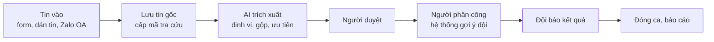
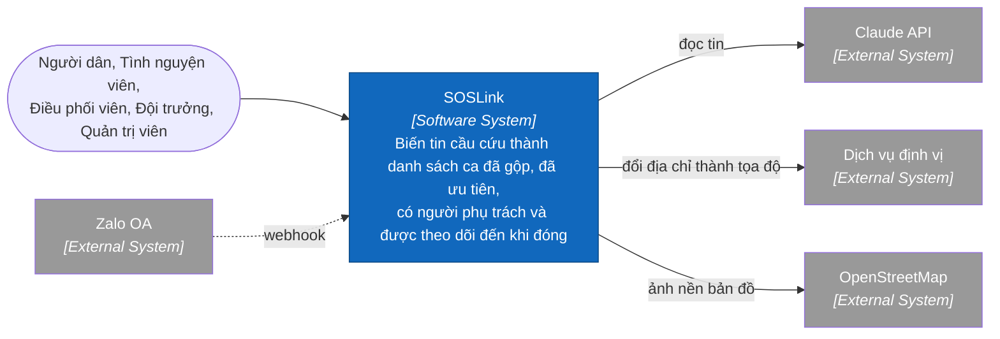
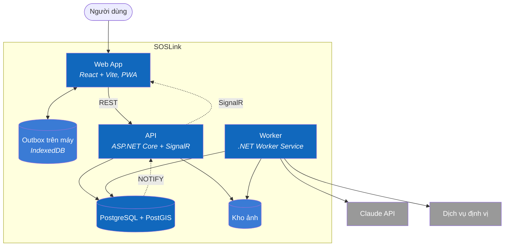

# SOSLink — AI-assisted Coordination of Flood Rescue Requests

> Design status: **TARGET V1** · Phase: **Requirements & Design**

**SOSLink** turns a large volume of messy flood rescue messages into **a list of cases that are merged, prioritised, owned by someone and tracked until closed**. AI reads messages, extracts information, and suggests merges and priorities; **people review and assign**.

---

## 1. Project introduction

### 1.1 Context

When water rises at night, many people [post calls for help on Facebook and Zalo](https://plo.vn/lu-dang-trong-dem-nguoi-dan-quang-tri-len-mang-cau-cuu-post597642.html). Volume spikes: in 2020, Zalo recorded [over 10,000 calls for help in 4 days](https://znews.vn/nhung-dem-thuc-trang-va-hon-10000-loi-keu-cuu-tren-zalo-post1149198.html). The floods of late 11/2025 left [113 dead in Đắk Lắk alone](https://tuoitre.vn/mua-lu-tai-dak-lak-lam-113-nguoi-chet-bo-cong-an-dang-dieu-tra-xa-lu-cua-thuy-dien-song-ba-ha-20251219191239907.htm).

### 1.2 The gap

Solutions such as [Zalo SOS](https://phongvu.vn/cong-nghe/?p=98453) and [thongtincuuho.org](https://tuoitre.vn/sau-dem-lu-kinh-hoang-hai-ban-tre-am-tham-xay-ban-do-cuu-ho-cuu-nan-cho-nguoi-dan-thai-nguyen-20251008152801823.htm) answer **"who needs rescue, and where"** fairly well. SOSLink focuses on what comes next:

> **"Has anyone gone yet? Who? Is it done?"**

| Code | Pain point | Consequence |
|---|---|---|
| P1 | Free-form messages, abbreviations, missing information | Time lost reading and calling back |
| P2 | Message volume spikes | Overload, missed messages |
| P3 | One case is posted many times | Several teams go to one place, nobody goes elsewhere |
| P4 | Old messages, unverified messages | Wasted resources |
| P5 | Prioritising by gut feeling | Dangerous cases handled late |
| P6 | Nobody knows which cases were rescued | The loop never closes |
| P7 | Senders do not know if their message was received | Panic, repeated posting |

Except for P2, these pain points **are hypotheses** built from press coverage, to be validated by interviewing rescue groups. Details: [docs/01-research.md](docs/01-research.md).

### 1.3 Automated AI workflow



**Safety principles:** no message is ever lost · AI only suggests · when unsure, go higher · the system keeps running when AI fails. Details: [docs/02-scope.md](docs/02-scope.md).

### 1.4 Out of scope for V1

Automatically scanning social media, replacing the 112 hotline, a public map with personal data, routing around flooded roads, managing relief goods, training a custom model.

---

## 2. Product mindmap

See the original on Xmind: **[SOSLink — Product Mindmap](https://app.xmind.com/share/R30DAqtM)**. Each branch has its own colour.


---

## 3. Roles & permissions

| Role | Code | Description |
|---|---|---|
| Resident | — | Sends messages, looks up by code; no account needed |
| Volunteer | `VOLUNTEER` | Pastes messages from social media, records verification |
| Coordinator | `COORDINATOR` | Reviews cases, merges messages, assigns teams, views reports |
| Rescue team | `TEAM` | Receives missions, reports outcomes |
| Administrator | `ADMIN` | Full coordination rights + accounts, teams, configuration, audit log |

| Function | Resident | VOLUNTEER | COORDINATOR | TEAM | ADMIN |
|---|:---:|:---:|:---:|:---:|:---:|
| Send through the form, look up by code | ✓ | | | | |
| Paste messages, screenshots | | ✓ | ✓ | | ✓ |
| View messages | | Own | All | Assigned cases | All |
| Review, merge, change priority | | | ✓ | | ✓ |
| Assign teams | | | ✓ | | ✓ |
| Receive missions, report outcomes | | | | ✓ | |
| Reports | | | ✓ | | ✓ |
| AI quality, audit log, configuration | | | | | ✓ |

The backend checks permissions on every API call. Full matrix: [docs/03-use-cases.md](docs/03-use-cases.md).

---

## 4. Overall use case


List of 24 use cases and flow specifications: [docs/03-use-cases.md](docs/03-use-cases.md).

---

## 5. User stories — INVEST

The backlog has **24 user stories** (17 Must · 5 Should · 2 Could), each assessed against INVEST and with acceptance criteria.

| Criterion | Meaning in SOSLink |
|---|---|
| **I**ndependent | Each story can be demoed alone |
| **N**egotiable | The interface can change; safety rules cannot |
| **V**aluable | Tied to a role and a pain point P1–P7 |
| **E**stimable | Inputs, outputs, rules and exceptions are written down |
| **S**mall | Done in ≤ 3 person-days |
| **T**estable | Has observable acceptance criteria |

| Group | Stories |
|---|---|
| Accounts | US01 Log in · US02 Profile |
| Intake | US03 Send message · US04 Look up · US05 Paste message · US06 Zalo OA |
| AI processing | US07 Extraction · US08 Geocoding · US09 Duplicate suggestions · US10 Priority suggestions |
| Case review | US11 Review · US12 Merge, undo · US13 Verification |
| Dispatch | US14 Map, queue · US15 Assignment · US16 Alerts |
| Rescue teams | US17 Receive mission · US18 Report outcome |
| Reports | US19 Dashboard · US20 AI quality |
| Administration | US21 Accounts · US22 Teams · US23 Disaster events · US24 Audit log, anonymisation |

Full backlog, INVEST table and acceptance criteria: [docs/04-user-stories.md](docs/04-user-stories.md).

---

## 6. Information architecture

```text
SOSLink
├── Public pages: Send message · Look up by code
├── Intake (VOLUNTEER): New message · My messages
├── Command centre (COORDINATOR, ADMIN)
│   ├── Command map → Assign team · Alerts
│   ├── Awaiting review → Review case → Compare and merge
│   ├── All cases → Case detail
│   └── Reports
├── Missions (TEAM): List → Detail → Report outcome
└── Administration (ADMIN): Disaster events · Accounts · Teams · AI quality · Audit log
```

Screen hierarchy, 28 screens, routes, flows and states: [docs/05-information-architecture.md](docs/05-information-architecture.md).

---

## 7. UI/UX

Design and main screens: [docs/06-ui-ux.md](docs/06-ui-ux.md). Screenshots by role: [docs/screenshots/](docs/screenshots/README.md).


The interface is in Vietnamese. It is a sample interface, not connected to a backend. **All data in the images is sample data**, including names, teams, phone numbers, figures and rescue cases; map locations are only estimates.

---

## 8. Data

The DBML has 19 tables; **original messages (`reports`) are separate from normalised cases (`cases`)** so messages can be merged without losing data: [docs/07-data-model.md](docs/07-data-model.md) · [docs/database/soslink.dbml](docs/database/soslink.dbml).

---

## 9. OpenAPI

API contract in OpenAPI 3.0.4, base `/api/v1`, JWT authentication for 60 minutes, errors per RFC 7807. Each operation states which roles may call it and which stories it serves; US01–US24 are all covered.

```text
58 paths · 68 operations · 16 groups
Resending creates no duplicates: idempotencyKey, clientUpdateId
Preventing duplicate assignment: version and partial unique index
Public pages return no personal data
```

[OpenAPI specification](docs/api/openapi.yaml) · [Documentation and sample calls](docs/api/README.md).

---

## 10. C4 architecture

### C1 — System context



### C2 — Containers



The Worker is separate from the API so that slow or failing AI does not block intake. The queue lives in PostgreSQL, so a message and the work to do on it are written in the same transaction.

C1–C4 details and two sequence diagrams: [docs/architecture/c4](docs/architecture/c4/README.md).

---

## 11. Code structure

```text
src/
├── frontend/          # React + Vite: features by screen, outbox for offline use
├── backend/
│   ├── SOSLink.Api/             # Controllers, SignalR
│   ├── SOSLink.Worker/          # AI, overdue alerts, anonymisation
│   ├── SOSLink.Application/     # Business logic, framework-independent
│   └── SOSLink.Infrastructure/  # EF Core, Claude API, geocoding, image store
└── database/seed/     # Demo data
```

The technology is a default choice and can change. Full folder tree, dependency rules and module mapping: [docs/08-code-structure.md](docs/08-code-structure.md).

---

## 12. Documents

| # | Requirement | Document | Status |
|---|---|---|---|
| 1 | Top-down problem analysis | [01-research.md](docs/01-research.md) · [02-scope.md](docs/02-scope.md) | ✅ |
| 2 | Use case diagram, INVEST user stories | [03-use-cases.md](docs/03-use-cases.md) · [04-user-stories.md](docs/04-user-stories.md) | ✅ |
| 3 | Information architecture | [05-information-architecture.md](docs/05-information-architecture.md) | ✅ |
| 4 | UI/UX | [06-ui-ux.md](docs/06-ui-ux.md) | ✅ |
| 5 | DBML | [07-data-model.md](docs/07-data-model.md) · [soslink.dbml](docs/database/soslink.dbml) | ✅ |
| 6 | OpenAPI | [openapi.yaml](docs/api/openapi.yaml) · [README](docs/api/README.md) | ✅ |
| 7 | C4 documentation | [docs/architecture/c4](docs/architecture/c4/README.md) | ✅ |
| 8 | Code structure | [08-code-structure.md](docs/08-code-structure.md) | ✅ |
| 9 | Code | — | ⏳ Not started |
