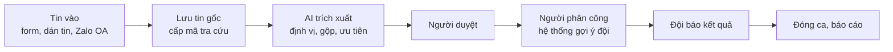
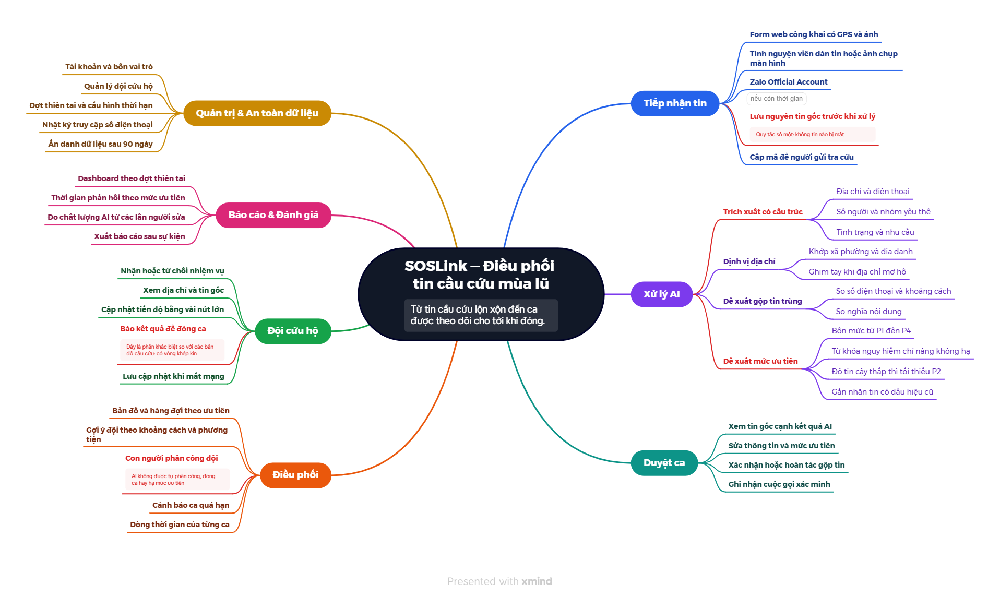
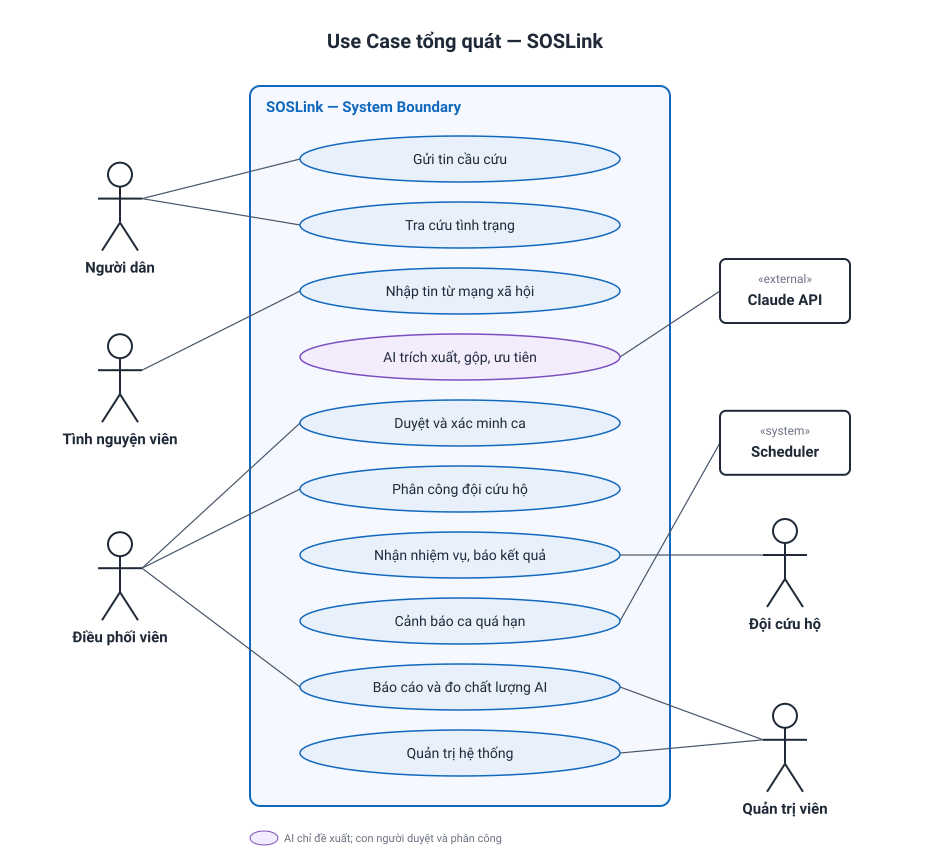
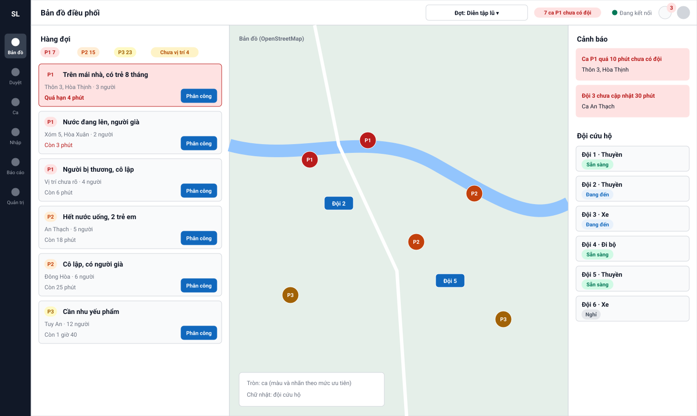

# SOSLink — Điều phối tin cầu cứu mùa lũ bằng AI

> Trạng thái thiết kế: **TARGET V1** · Giai đoạn: **Requirements & Design**

**SOSLink** biến lượng lớn tin cầu cứu lộn xộn trong mùa lũ thành **danh sách ca đã gộp, đã ưu tiên, có người phụ trách và được theo dõi đến khi đóng**. AI đọc tin, trích thông tin, đề xuất gộp và mức ưu tiên; **con người duyệt và phân công**.

---

## 1. Giới thiệu dự án

### 1.1 Bối cảnh

Khi nước dâng trong đêm, nhiều người [đăng tin cầu cứu trên Facebook và Zalo](https://plo.vn/lu-dang-trong-dem-nguoi-dan-quang-tri-len-mang-cau-cuu-post597642.html). Số lượng tăng đột biến: năm 2020, Zalo ghi nhận [hơn 10.000 lời kêu cứu trong 4 ngày](https://znews.vn/nhung-dem-thuc-trang-va-hon-10000-loi-keu-cuu-tren-zalo-post1149198.html). Đợt mưa lũ cuối tháng 11/2025 làm [113 người chết riêng ở Đắk Lắk](https://tuoitre.vn/mua-lu-tai-dak-lak-lam-113-nguoi-chet-bo-cong-an-dang-dieu-tra-xa-lu-cua-thuy-dien-song-ba-ha-20251219191239907.htm).

### 1.2 Khoảng trống

Các giải pháp như [Zalo SOS](https://phongvu.vn/cong-nghe/?p=98453) và [thongtincuuho.org](https://tuoitre.vn/sau-dem-lu-kinh-hoang-hai-ban-tre-am-tham-xay-ban-do-cuu-ho-cuu-nan-cho-nguoi-dan-thai-nguyen-20251008152801823.htm) đã trả lời khá tốt câu hỏi **"ai cần cứu, ở đâu"**. SOSLink tập trung vào phần tiếp theo:

> **"Đã có ai đi cứu chưa? Ai đi? Xong chưa?"**

| Mã | Painpoint | Hậu quả |
|---|---|---|
| P1 | Tin tự do, viết tắt, thiếu thông tin | Mất thời gian đọc, gọi lại |
| P2 | Lượng tin tăng đột biến | Quá tải, bỏ sót |
| P3 | Một ca được đăng nhiều lần | Nhiều đội đến một nơi, nơi khác không có ai |
| P4 | Tin cũ, tin chưa xác minh | Lãng phí lực lượng |
| P5 | Ưu tiên theo cảm tính | Ca nguy hiểm bị xử lý muộn |
| P6 | Không biết ca nào đã được cứu | Không khép được vòng |
| P7 | Người gửi không biết tin đã được nhận chưa | Hoảng loạn, đăng lại nhiều lần |

Trừ P2, các painpoint trên **là giả thuyết** dựng từ báo chí, cần kiểm chứng bằng phỏng vấn nhóm cứu hộ. Chi tiết: [docs/01-research.md](docs/01-research.md).

### 1.3 Workflow AI tự động



**Nguyên tắc an toàn:** không tin nào bị mất · AI chỉ đề xuất · không chắc thì ưu tiên cao hơn · hệ thống vẫn chạy khi AI hỏng. Chi tiết: [docs/02-scope.md](docs/02-scope.md).

### 1.4 Ngoài phạm vi V1

Tự quét mạng xã hội, thay thế tổng đài 112, bản đồ công khai chứa dữ liệu cá nhân, dẫn đường theo đường ngập, quản lý hàng cứu trợ, tự train model.

---

## 2. Product Mindmap

Xem bản gốc trên Xmind: **[SOSLink — Product Mindmap](https://app.xmind.com/share/R30DAqtM)**. Mỗi nhánh có một màu riêng; các ý quan trọng nhất được in đậm màu đỏ.



---

## 3. Vai trò & Phân quyền

| Vai trò | Mã | Mô tả |
|---|---|---|
| Người dân | — | Gửi tin, tra cứu bằng mã; không cần tài khoản |
| Tình nguyện viên | `VOLUNTEER` | Dán tin từ mạng xã hội, ghi nhận xác minh |
| Điều phối viên | `COORDINATOR` | Duyệt ca, gộp tin, phân công đội, xem báo cáo |
| Đội cứu hộ | `TEAM` | Nhận nhiệm vụ, báo kết quả |
| Quản trị viên | `ADMIN` | Toàn quyền điều phối + tài khoản, đội, cấu hình, nhật ký |

| Chức năng | Người dân | VOLUNTEER | COORDINATOR | TEAM | ADMIN |
|---|:---:|:---:|:---:|:---:|:---:|
| Gửi tin qua form, tra cứu bằng mã | ✓ | | | | |
| Dán tin, ảnh chụp | | ✓ | ✓ | | ✓ |
| Xem tin | | Của mình | Tất cả | Ca được giao | Tất cả |
| Duyệt, gộp tin, đổi ưu tiên | | | ✓ | | ✓ |
| Phân công đội | | | ✓ | | ✓ |
| Nhận nhiệm vụ, báo kết quả | | | | ✓ | |
| Báo cáo | | | ✓ | | ✓ |
| Chất lượng AI, nhật ký, cấu hình | | | | | ✓ |

Backend kiểm tra quyền trên mọi API. Ma trận đầy đủ: [docs/03-use-cases.md](docs/03-use-cases.md).

---

## 4. Use Case tổng quát



Danh sách 24 use case và đặc tả luồng: [docs/03-use-cases.md](docs/03-use-cases.md).

---

## 5. User Stories — INVEST

Backlog gồm **24 user story** (17 Must · 5 Should · 2 Could), mỗi story đều được đánh giá theo INVEST và có acceptance criteria.

| Tiêu chí | Ý nghĩa trong SOSLink |
|---|---|
| **I**ndependent | Mỗi story demo được riêng |
| **N**egotiable | Giao diện có thể đổi; quy tắc an toàn thì không |
| **V**aluable | Gắn với một vai trò và painpoint P1–P7 |
| **E**stimable | Đầu vào, đầu ra, quy tắc, ngoại lệ được ghi rõ |
| **S**mall | Làm xong trong ≤ 3 ngày/người |
| **T**estable | Có acceptance criteria quan sát được |

| Nhóm | Stories |
|---|---|
| Tài khoản | US01 Đăng nhập · US02 Hồ sơ |
| Tiếp nhận | US03 Gửi tin · US04 Tra cứu · US05 Dán tin · US06 Zalo OA |
| Xử lý AI | US07 Trích xuất · US08 Định vị · US09 Đề xuất trùng · US10 Đề xuất ưu tiên |
| Duyệt ca | US11 Duyệt · US12 Gộp, hoàn tác · US13 Xác minh |
| Điều phối | US14 Bản đồ, hàng đợi · US15 Phân công · US16 Cảnh báo |
| Đội cứu hộ | US17 Nhận nhiệm vụ · US18 Báo kết quả |
| Báo cáo | US19 Dashboard · US20 Chất lượng AI |
| Quản trị | US21 Tài khoản · US22 Đội · US23 Đợt thiên tai · US24 Nhật ký, ẩn danh |

Backlog đầy đủ, bảng INVEST và acceptance criteria: [docs/04-user-stories.md](docs/04-user-stories.md).

---

## 6. Information Architecture

```text
SOSLink
├── Trang công khai: Gửi tin · Tra cứu bằng mã
├── Nhập tin (VOLUNTEER): Nhập tin mới · Tin của tôi
├── Trung tâm điều phối (COORDINATOR, ADMIN)
│   ├── Bản đồ điều phối → Phân công đội · Cảnh báo
│   ├── Chờ duyệt → Duyệt ca → So sánh gộp tin
│   ├── Tất cả ca → Chi tiết ca
│   └── Báo cáo
├── Nhiệm vụ (TEAM): Danh sách → Chi tiết → Báo kết quả
└── Quản trị (ADMIN): Đợt thiên tai · Tài khoản · Đội · Chất lượng AI · Nhật ký
```

Screen hierarchy, 28 màn hình, route, luồng và trạng thái: [docs/05-information-architecture.md](docs/05-information-architecture.md).

---

## 7. UI/UX

Wireframe low-fi cho 8 màn hình chính: [docs/06-ui-ux.md](docs/06-ui-ux.md).



---

## 8. Dữ liệu

DBML gồm 19 bảng; **tách tin gốc (`reports`) khỏi ca đã chuẩn hóa (`cases`)** để gộp tin mà không mất dữ liệu: [docs/07-data-model.md](docs/07-data-model.md) · [docs/database/soslink.dbml](docs/database/soslink.dbml).

---

## 9. Tài liệu

| # | Yêu cầu | Tài liệu | Trạng thái |
|---|---|---|---|
| 1 | Phân tích đề bài top-down | [01-research.md](docs/01-research.md) · [02-scope.md](docs/02-scope.md) | ✅ |
| 2 | Use case diagram, User stories INVEST | [03-use-cases.md](docs/03-use-cases.md) · [04-user-stories.md](docs/04-user-stories.md) | ✅ |
| 3 | Information architecture | [05-information-architecture.md](docs/05-information-architecture.md) | ✅ |
| 4 | UI/UX | [06-ui-ux.md](docs/06-ui-ux.md) | ✅ |
| 5 | DBML | [07-data-model.md](docs/07-data-model.md) · [soslink.dbml](docs/database/soslink.dbml) | ✅ |
| 6 | OpenAPI | — | ⏳ Chưa làm |
| 7 | C4 Documentation | — | ⏳ Chưa làm |
| 8 | Code structure | — | ⏳ Chưa làm |
| 9 | Code | — | ⏳ Chưa làm |

Slide deck: [slides/SOSLink-deck.pptx](slides/SOSLink-deck.pptx) · [hướng dẫn nhập vào Google Slides và thêm hiệu ứng](slides/README.md).
