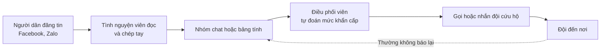
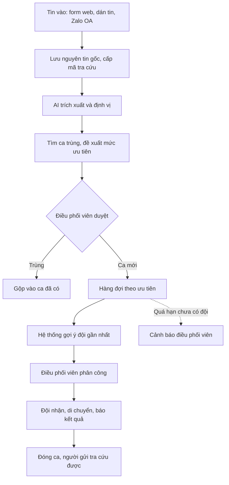

# 01 — Top-down Problem Analysis (Research)

> Design status: **TARGET V1**
>
> Method: from **context → gap → goal → capabilities → modules → features**.
>
> **Level of evidence:** this document is based on press coverage and public research. I **have not interviewed** real coordinators or rescue teams, so anything without a source is marked as a *hypothesis*.

---

## 1. Context

### 1.1 Severity

| Event | Figures | Source |
|---|---|---|
| Typhoon Yagi, 9/2024 | 345 dead and missing (323 dead, 22 missing), per the Government's report to the National Assembly, 10/2024 | [Báo Đầu tư](https://baodautu.vn/chinh-phu-bao-cao-quoc-hoi-tinh-hinh-thiet-hai-va-khac-phuc-hau-qua-bao-yagi-d228038.html) |
| Floods, late 11/2025 | 113 dead in Đắk Lắk alone, 101 of them directly from the floods (provincial People's Committee, 19/12/2025) | [Tuổi Trẻ](https://tuoitre.vn/mua-lu-tai-dak-lak-lam-113-nguoi-chet-bo-cong-an-dang-dieu-tra-xa-lu-cua-thuy-dien-song-ba-ha-20251219191239907.htm) |

These figures vary with the date and scope of each count. Check them against the latest official report before putting them on a slide.

### 1.2 People call for help on social media

- When water rises at night, people [post calls for help on Facebook and Zalo](https://plo.vn/lu-dang-trong-dem-nguoi-dan-quang-tri-len-mang-cau-cuu-post597642.html), some [trapped on rooftops with small children](https://vietnamnet.vn/en/trapped-on-rooftops-families-plead-for-help-on-facebook-amid-sudden-floods-2464633.html).
- Volume spikes in a short time: in 2020, Zalo recorded [over 10,000 calls for help in 4 days](https://znews.vn/nhung-dem-thuc-trang-va-hon-10000-loi-keu-cuu-tren-zalo-post1149198.html). During Typhoon Bualoi in 2025, [about 70,000 people reported being in trouble](https://nongnghiepmoitruong.vn/gan-1-ty-canh-bao-thien-tai-duoc-gui-toi-nguoi-dan-qua-zalo-d778845.html) on Zalo.
- International research also finds that major floods create [many simultaneous rescue requests that overload the response system](https://par.nsf.gov/servlets/purl/10470798).

---

## 2. Existing solutions

**Others already work on this problem**, so this project has to answer "how is it different from what exists".

| Solution | What it does | What public sources do not show |
|---|---|---|
| [Zalo SOS](https://phongvu.vn/cong-nghe/?p=98453) | Users send their location and condition, shown as a red dot on a map; [connected to the 112 hotline](https://nongnghiepmoitruong.vn/gan-1-ty-canh-bao-thien-tai-duoc-gui-toi-nguoi-dan-qua-zalo-d778845.html); [has a map since late 11/2025](https://nongnghiepmoitruong.vn/zalo-dua-gan-1-ty-thong-bao-canh-bao-thien-tai-toi-nguoi-dan-d803703.html), and the dot turns green when rescuers mark it as helped | Only receives messages from people who turn the feature on; does not process free-form posts |
| [thongtincuuho.org](https://tuoitre.vn/sau-dem-lu-kinh-hoang-hai-ban-tre-am-tham-xay-ban-do-cuu-ho-cuu-nan-cho-nguoi-dan-thai-nguyen-20251008152801823.htm) (2025) | Scans posts and comments, uses AI to recognise place names, pins points on a map; [nearly 3,000 users in 24 hours](https://vtcnews.vn/hai-ban-tre-lap-website-tong-hop-hang-nghin-loi-keu-cuu-giua-mua-lu-ar970052.html) | Rescue teams still open the original link themselves; the article does not mention merging duplicates, verification, assignment or closing cases |
| [cuuhomientrung.info](https://tuoitre.vn/ung-dung-cong-nghe-ho-tro-cuu-ho-lu-lut-tai-dia-chi-cuuhomientrung-info-20201022122411161.htm) (2020) | Over 2,000 volunteers compile data, with a hotline and 30 people on duty | Depends heavily on manpower; unclear how each case's status is tracked |
| [totomo.org, antoanmualu.org](https://www.thiennguyen.org/group/hoat-dong-thien-nguyen/discussion/421c968b-7058-4817-b0a4-3072eb8e312f) (2025) | Compile calls for help, with a button to send GPS location | Not evaluated in depth yet |
| 112 hotline | Official channel, staffed 24/7 | Cannot be replaced, and is not a competitor |

> **Limit of this table:** "not shown in sources" **does not mean** those projects lack the feature. I could not access thongtincuuho.org during the survey, so these tools need hands-on testing, and their operators need asking, before making any claim.

### Gap and direction

Existing solutions focus on **"who needs rescue, and where"**: putting red dots on a map. SOSLink focuses on what comes next:

> **"Has anyone gone yet? Who? Is it done?"**

That means turning a large volume of messy messages into **a list of cases that are merged, prioritised, owned by someone and tracked until closed**. SOSLink should **complement** existing maps, not compete with them directly.

---

## 3. Stakeholders

| Stakeholder | Goal | Concern |
|---|---|---|
| **People in danger and their relatives** | Someone comes to rescue them | Has anyone received my message, and when will someone come |
| **Volunteers on message duty** | No message is missed | Too many messages, messages with missing information |
| **Coordinators** | Send the right team to the most urgent case | Which case first, which team is free, which case was forgotten |
| **Rescue teams** | Reach the right place safely | Accurate address, not going where someone has already helped |
| **Group leader / operating unit** | Run effectively and accountably | Figures, logs, personal data protection |

---

## 4. Current process (As-is)

> This is a **hypothesis** built from news articles, to be confirmed by interviewing real rescue groups.

| Code | Pain point | Consequence | Evidence |
|---|---|---|---|
| P1 | Free-form messages, abbreviations, missing address or phone number | Time lost reading and calling back | Hypothesis; the thongtincuuho team says rescue is ["not as simple as reading a message and going to help"](https://tuoitre.vn/sau-dem-lu-kinh-hoang-hai-ban-tre-am-tham-xay-ban-do-cuu-ho-cuu-nan-cho-nguoi-dan-thai-nguyen-20251008152801823.htm) |
| P2 | Message volume spikes when floods rise | Overload, missed messages | Sourced (section 1.2) |
| P3 | One case is reposted by many people | Several teams go to one place, nobody goes elsewhere | Hypothesis |
| P4 | Old messages reshared, unverified messages | Wasted resources | Hypothesis; [research](https://digitalcommons.odu.edu/emse_etds/235) treats verification as a key issue |
| P5 | Prioritising by gut feeling | Dangerous cases may be handled late | Hypothesis |
| P6 | Nobody knows which cases were rescued | The loop never closes, duplicate rescues | Hypothesis |
| P7 | Senders do not know if their message was received | Panic, reposting (which worsens P3) | Hypothesis |

---

## 5. Why AI is needed

Hard rules cannot read a message like this (an example I wrote myself):

> *"cứu vs ạ, nhà e ở gần cầu Sông Ba thôn 3 hòa thịnh, nc lên tới mái r, có 2 cụ già vs bé 8 tháng, đt 09xx xx1234 goi ko dc thì gọi số chị e"*

| Step | What AI can do | Why rules are not enough |
|---|---|---|
| Extraction | Address, number of people, vulnerable groups, water level, phone | Abbreviations, missing diacritics, free word order |
| Reading screenshots | Gets the content from an image of a post | It is an image, not text |
| Merging duplicates | Compares whether two messages mean the same case | Different wording, vague addresses |
| Urgency signals | Recognises "mái nhà" (roof), "bé 8 tháng" (8-month-old baby), "nước đang lên" (water rising) | Endless ways of phrasing |
| Old-message signals | Recognises time references in the content | Repost time differs from event time |

**Feasibility has a basis:** the BERT model [VictimFinder](https://aag-amarchive.secure-platform.com:443/a/solicitations/13/sessiongallery/1303/application/1987) reached F1 0.919 at identifying calls for help during Hurricane Harvey, on 3,191 labelled English tweets. This figure **does not apply directly** to Vietnamese, so I have to measure it myself (section 9).

**No custom model training:** use an existing multimodal model API and require JSON output in a fixed schema.

**AI must not decide on its own:** lives are at stake. AI only prepares and suggests; people assign teams and close cases (see [02-scope.md](02-scope.md)).

---

## 6. Top-down decomposition

### 6.1 Product goal

> **"During a flood, no call for help is missed, and the most dangerous case is handled first."**

### 6.2 Capabilities → Modules

| Code | Capability | Solves | Module |
|---|---|---|---|
| C1 | Receive messages from many channels | P2, P7 | M2 Intake |
| C2 | Turn messy messages into structured data | P1 | M3 AI processing |
| C3 | Merge duplicate messages into one case | P3 | M3 AI processing, M4 Case review |
| C4 | Prioritise and verify | P4, P5 | M3 AI processing, M4 Case review |
| C5 | Assign and track until the case closes | P6 | M5 Dispatch, M6 Rescue teams |
| C6 | Give feedback to the person calling for help | P7 | M2 Intake |
| C7 | Administration, accountability, post-event learning | All | M1 Accounts, M7 Reports, M8 Administration |

---

## 7. Target process (To-be)

---

## 8. Data

Data source details: [02-scope.md](02-scope.md#6-data-sources).

| Purpose | Source |
|---|---|
| Incoming messages in operation | Web form, volunteers pasting messages, Zalo OA |
| Measuring accuracy | 100–200 anonymised public posts + simulated messages, labelled by hand |
| Demo | Replay the message set along a timeline |

## 9. Assumptions to validate

| # | Assumption | How to validate | Confirmation criterion (proposed) |
|---|---|---|---|
| A1 | Rescue groups coordinate with group chats and spreadsheets | Interview 3–5 groups in Central Vietnam | ≥ 3 groups confirm |
| A2 | Duplicate messages and duplicate rescues really happen | Ask for concrete examples, look at sample messages | Real examples exist |
| A3 | AI extracts correctly from real Vietnamese messages | Measure on the 100–200 message set | Phone ≥ 95%, address ≥ 80%, number of people ≥ 85% |
| A4 | AI does not miss dangerous cases | Measure P1 recall | ≥ 95% |
| A5 | Rescue groups are willing to use a new tool during an emergency | Let them try the demo | ≥ 2 groups willing to try next flood season |

**Suggested interview questions:**
1. In the latest flood, where did your group receive messages from, and about how many per hour?
2. What tool does the group use to record and assign?
3. Have two teams ever gone to the same place, or has a case been missed? Why?
4. How do you know a case has been rescued?
5. What information is most often missing when going on a rescue?
6. Do you use thongtincuuho.org or Zalo SOS? What is still missing?

## 10. Success metrics

These are **proposed targets**; there are no baseline measurements yet.

| Metric | V1 target | How measured |
|---|---|---|
| Time from message in to ready for review | ≤ 30 seconds | System logs |
| Time to review a case compared with doing it by hand | ≥ 50% less | Test with the same message set |
| Recall of dangerous cases (P1) | ≥ 95% | Labelled message set |
| Precision of duplicate suggestions | ≥ 85% | Labelled message set |
| Lost messages | 0 | Compare incoming messages with cases |
| Cases with no final status when a drill ends | 0 | Report |

---

**Related:** [Scope & rules](02-scope.md) · [Use cases](03-use-cases.md) · [User stories](04-user-stories.md)
