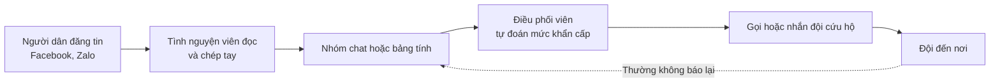
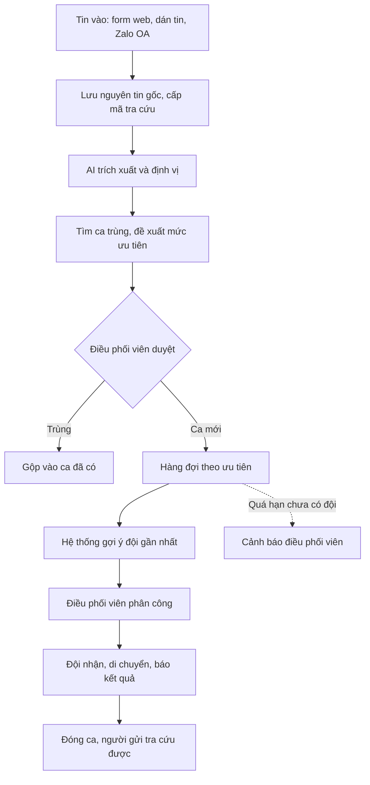

# 01 — Phân tích đề bài Top-down (Research)

> Trạng thái thiết kế: **TARGET V1**
>
> Phương pháp: đi từ **bối cảnh → khoảng trống → mục tiêu → năng lực → phân hệ → tính năng**.
>
> **Mức độ bằng chứng:** tài liệu này dựa trên báo chí và nghiên cứu công khai. Nhóm **chưa phỏng vấn** điều phối viên hay đội cứu hộ thật, nên các điểm chưa có nguồn được ghi rõ là *giả thuyết*.

---

## 1. Bối cảnh

### 1.1 Mức độ nghiêm trọng

| Sự kiện | Số liệu | Nguồn |
|---|---|---|
| Bão Yagi, 9/2024 | 345 người chết và mất tích (323 chết, 22 mất tích), theo báo cáo của Chính phủ gửi Quốc hội, 10/2024 | [Báo Đầu tư](https://baodautu.vn/chinh-phu-bao-cao-quoc-hoi-tinh-hinh-thiet-hai-va-khac-phuc-hau-qua-bao-yagi-d228038.html) |
| Mưa lũ cuối 11/2025 | Riêng Đắk Lắk có 113 người chết, trong đó 101 người do mưa lũ trực tiếp (UBND tỉnh, 19/12/2025) | [Tuổi Trẻ](https://tuoitre.vn/mua-lu-tai-dak-lak-lam-113-nguoi-chet-bo-cong-an-dang-dieu-tra-xa-lu-cua-thuy-dien-song-ba-ha-20251219191239907.htm) |

Các con số thay đổi theo thời điểm và phạm vi thống kê. Khi đưa vào slide, cần đối chiếu với báo cáo chính thức mới nhất.

### 1.2 Người dân cầu cứu qua mạng xã hội

- Khi nước dâng trong đêm, người dân [đăng tin cầu cứu trên Facebook và Zalo](https://plo.vn/lu-dang-trong-dem-nguoi-dan-quang-tri-len-mang-cau-cuu-post597642.html), có người [mắc kẹt trên mái nhà cùng con nhỏ](https://vietnamnet.vn/en/trapped-on-rooftops-families-plead-for-help-on-facebook-amid-sudden-floods-2464633.html).
- Số lượng tăng đột biến trong thời gian ngắn: năm 2020, Zalo ghi nhận [hơn 10.000 lời kêu cứu trong 4 ngày](https://znews.vn/nhung-dem-thuc-trang-va-hon-10000-loi-keu-cuu-tren-zalo-post1149198.html). Trong bão Bualoi năm 2025, [khoảng 70 nghìn người báo đang gặp khó khăn](https://nongnghiepmoitruong.vn/gan-1-ty-canh-bao-thien-tai-duoc-gui-toi-nguoi-dan-qua-zalo-d778845.html) trên Zalo.
- Nghiên cứu quốc tế cũng ghi nhận lũ lớn tạo ra [nhiều yêu cầu cứu hộ cùng lúc, gây quá tải hệ thống ứng phó](https://par.nsf.gov/servlets/purl/10470798).

---

## 2. Các giải pháp đã có

**Bài toán này đã có người làm**, và đề tài phải trả lời được câu hỏi "khác gì những gì đã có".

| Giải pháp | Làm được gì | Điều chưa thấy trong nguồn công khai |
|---|---|---|
| [Zalo SOS](https://phongvu.vn/cong-nghe/?p=98453) | Người dùng gửi vị trí và tình trạng, hiện chấm đỏ trên bản đồ; [có kết nối tổng đài 112](https://nongnghiepmoitruong.vn/gan-1-ty-canh-bao-thien-tai-duoc-gui-toi-nguoi-dan-qua-zalo-d778845.html); [từ cuối 11/2025 có bản đồ](https://nongnghiepmoitruong.vn/zalo-dua-gan-1-ty-thong-bao-canh-bao-thien-tai-toi-nguoi-dan-d803703.html), lực lượng cứu hộ đánh dấu đã hỗ trợ thì chấm chuyển xanh | Chỉ nhận tin từ người bật tính năng; không xử lý bài đăng tự do |
| [thongtincuuho.org](https://tuoitre.vn/sau-dem-lu-kinh-hoang-hai-ban-tre-am-tham-xay-ban-do-cuu-ho-cuu-nan-cho-nguoi-dan-thai-nguyen-20251008152801823.htm) (2025) | Tự quét bài đăng và bình luận, AI nhận diện địa danh, gắn điểm lên bản đồ; [gần 3.000 người dùng trong 24 giờ](https://vtcnews.vn/hai-ban-tre-lap-website-tong-hop-hang-nghin-loi-keu-cuu-giua-mua-lu-ar970052.html) | Đội cứu hộ vẫn tự mở link gốc; bài báo không nói về gộp tin trùng, xác minh, phân công và đóng ca |
| [cuuhomientrung.info](https://tuoitre.vn/ung-dung-cong-nghe-ho-tro-cuu-ho-lu-lut-tai-dia-chi-cuuhomientrung-info-20201022122411161.htm) (2020) | Hơn 2.000 tình nguyện viên tổng hợp dữ liệu, có đường dây nóng và 30 người trực | Phụ thuộc rất nhiều vào nhân lực; không rõ trạng thái từng ca được theo dõi thế nào |
| [totomo.org, antoanmualu.org](https://www.thiennguyen.org/group/hoat-dong-thien-nguyen/discussion/421c968b-7058-4817-b0a4-3072eb8e312f) (2025) | Tổng hợp tin cầu cứu, nút gửi vị trí GPS | Nhóm chưa đánh giá sâu |
| Tổng đài 112 | Kênh chính thức, trực 24/7 | Không thay thế được, và không phải đối thủ |

> **Giới hạn của bảng này:** "chưa thấy trong nguồn" **không có nghĩa** là các dự án đó không có tính năng. Nhóm không truy cập được thongtincuuho.org khi khảo sát, nên cần dùng thử trực tiếp và hỏi người vận hành trước khi khẳng định.

### Khoảng trống và hướng đi

Các giải pháp hiện có tập trung vào câu hỏi **"ai đang cần cứu và ở đâu"**: đưa điểm đỏ lên bản đồ. SOSLink tập trung vào phần tiếp theo:

> **"Đã có ai đi cứu chưa? Ai đi? Xong chưa?"**

Nghĩa là biến một lượng lớn tin lộn xộn thành **danh sách ca đã gộp, đã ưu tiên, có người phụ trách và được theo dõi đến khi đóng**. SOSLink nên **bổ trợ** các bản đồ sẵn có, không cạnh tranh trực tiếp.

---

## 3. Các bên liên quan

| Bên liên quan | Mục tiêu | Mối quan tâm |
|---|---|---|
| **Người gặp nạn và người thân** | Có người đến cứu | Tin của mình có ai nhận chưa, bao giờ có người đến |
| **Tình nguyện viên trực tin** | Không bỏ sót tin nào | Quá nhiều tin, tin thiếu thông tin |
| **Điều phối viên** | Dùng đúng đội cho đúng ca khẩn cấp nhất | Ca nào trước, đội nào đang rảnh, ca nào bị bỏ quên |
| **Đội cứu hộ** | Đến đúng chỗ, an toàn | Địa chỉ chính xác, đừng đến nơi đã có người cứu |
| **Trưởng nhóm / đơn vị vận hành** | Vận hành hiệu quả, có trách nhiệm | Số liệu, nhật ký, bảo vệ dữ liệu cá nhân |

---

## 4. Quy trình hiện tại (As-is)

> Đây là **giả thuyết** dựng từ các bài báo, cần xác nhận khi phỏng vấn nhóm cứu hộ thật.

| Mã | Painpoint | Hậu quả | Bằng chứng |
|---|---|---|---|
| P1 | Tin dạng văn bản tự do, viết tắt, thiếu địa chỉ hoặc số điện thoại | Mất thời gian đọc và gọi lại | Giả thuyết; nhóm thongtincuuho cho biết cứu hộ ["không đơn giản là đọc tin rồi đi giúp"](https://tuoitre.vn/sau-dem-lu-kinh-hoang-hai-ban-tre-am-tham-xay-ban-do-cuu-ho-cuu-nan-cho-nguoi-dan-thai-nguyen-20251008152801823.htm) |
| P2 | Lượng tin tăng đột biến khi lũ lên | Quá tải, bỏ sót | Có nguồn (mục 1.2) |
| P3 | Một ca được nhiều người đăng lại | Nhiều đội đến một nơi, nơi khác không có ai | Giả thuyết |
| P4 | Tin cũ được chia sẻ lại, tin chưa xác minh | Lãng phí lực lượng | Giả thuyết; [nghiên cứu](https://digitalcommons.odu.edu/emse_etds/235) xem xác minh là vấn đề then chốt |
| P5 | Ưu tiên dựa vào cảm tính | Ca nguy hiểm có thể bị xử lý muộn | Giả thuyết |
| P6 | Không biết ca nào đã được cứu | Không đóng được vòng, cứu trùng | Giả thuyết |
| P7 | Người cầu cứu không biết tin đã được nhận chưa | Hoảng loạn, đăng lại nhiều lần (làm P3 nặng thêm) | Giả thuyết |

---

## 5. Vì sao cần AI

Quy tắc cứng không đọc được tin như thế này (ví dụ do nhóm tự viết):

> *"cứu vs ạ, nhà e ở gần cầu Sông Ba thôn 3 hòa thịnh, nc lên tới mái r, có 2 cụ già vs bé 8 tháng, đt 09xx xx1234 goi ko dc thì gọi số chị e"*

| Bước | AI làm được gì | Vì sao quy tắc không đủ |
|---|---|---|
| Trích xuất | Địa chỉ, số người, nhóm yếu thế, mức nước, điện thoại | Viết tắt, không dấu, thứ tự tự do |
| Đọc ảnh chụp màn hình | Lấy nội dung từ ảnh bài đăng | Ảnh, không phải văn bản |
| Gộp tin trùng | So nghĩa hai tin có cùng là một ca | Cách viết khác nhau, địa chỉ mơ hồ |
| Dấu hiệu khẩn cấp | Nhận ra "mái nhà", "bé 8 tháng", "nước đang lên" | Vô số cách diễn đạt |
| Dấu hiệu tin cũ | Nhận ra mốc thời gian trong nội dung | Thời điểm đăng lại khác thời điểm xảy ra |

**Tính khả thi đã có căn cứ:** mô hình BERT [VictimFinder](https://aag-amarchive.secure-platform.com:443/a/solicitations/13/sessiongallery/1303/application/1987) đạt F1 0,919 khi nhận diện tin cầu cứu trong bão Harvey, trên 3.191 tweet tiếng Anh đã gán nhãn. Con số này **không áp dụng trực tiếp** cho tiếng Việt, nên nhóm phải tự đo (mục 9).

**Không train model riêng:** dùng API mô hình đa phương thức có sẵn, bắt trả về JSON theo schema cố định.

**AI không được tự quyết:** đây là bối cảnh liên quan đến tính mạng. AI chỉ chuẩn bị và đề xuất; con người phân công và đóng ca (xem [02-scope.md](02-scope.md)).

---

## 6. Phân rã Top-down

### 6.1 Mục tiêu sản phẩm

> **"Trong đợt lũ, không một lời kêu cứu nào bị bỏ sót, và ca nguy hiểm nhất được xử lý trước."**

### 6.2 Năng lực → Phân hệ

| Mã | Năng lực | Giải quyết | Phân hệ |
|---|---|---|---|
| C1 | Tiếp nhận tin từ nhiều kênh | P2, P7 | M2 Tiếp nhận |
| C2 | Chuyển tin lộn xộn thành dữ liệu có cấu trúc | P1 | M3 Xử lý AI |
| C3 | Gộp tin trùng thành một ca | P3 | M3 Xử lý AI, M4 Duyệt ca |
| C4 | Ưu tiên và xác minh | P4, P5 | M3 Xử lý AI, M4 Duyệt ca |
| C5 | Phân công và theo dõi đến khi đóng ca | P6 | M5 Điều phối, M6 Đội cứu hộ |
| C6 | Phản hồi cho người cầu cứu | P7 | M2 Tiếp nhận |
| C7 | Quản trị, trách nhiệm, học sau sự kiện | Tất cả | M1 Tài khoản, M7 Báo cáo, M8 Quản trị |

---

## 7. Quy trình mục tiêu (To-be)

---

## 8. Dữ liệu

Chi tiết nguồn dữ liệu: [02-scope.md](02-scope.md#6-nguồn-dữ-liệu).

| Mục đích | Nguồn |
|---|---|
| Tin đầu vào khi vận hành | Form web, tình nguyện viên dán tin, Zalo OA |
| Đo độ chính xác | 100–200 bài công khai đã ẩn danh + tin giả lập, gán nhãn tay |
| Demo | Phát lại bộ tin trên theo dòng thời gian |

## 9. Giả định cần kiểm chứng

| # | Giả định | Cách kiểm chứng | Tiêu chí xác nhận (đề xuất) |
|---|---|---|---|
| A1 | Nhóm cứu hộ đang điều phối bằng nhóm chat, bảng tính | Phỏng vấn 3–5 nhóm ở miền Trung | ≥ 3 nhóm xác nhận |
| A2 | Tin trùng và cứu trùng thật sự xảy ra | Hỏi ví dụ cụ thể, xem mẫu tin | Có ví dụ thật |
| A3 | AI trích đúng thông tin trên tin tiếng Việt thực tế | Đo trên bộ 100–200 tin | Điện thoại ≥ 95%, địa chỉ ≥ 80%, số người ≥ 85% |
| A4 | AI không bỏ sót ca nguy hiểm | Đo recall của nhóm P1 | ≥ 95% |
| A5 | Nhóm cứu hộ sẵn sàng dùng công cụ mới giữa lúc khẩn cấp | Cho dùng thử bản demo | ≥ 2 nhóm sẵn sàng thử mùa lũ tới |

**Câu hỏi phỏng vấn gợi ý:**
1. Đợt lũ gần nhất, nhóm nhận tin từ đâu, mỗi giờ khoảng bao nhiêu tin?
2. Nhóm ghi lại và phân công bằng công cụ gì?
3. Đã từng có hai đội đến cùng một nơi, hoặc ca nào bị bỏ sót chưa? Vì sao?
4. Làm sao biết một ca đã được cứu?
5. Thông tin nào hay thiếu nhất khi đi cứu?
6. Có dùng thongtincuuho.org, Zalo SOS không? Còn thiếu gì?

## 10. Chỉ số thành công

Đây là **mục tiêu đề xuất**, chưa có số đo hiện trạng.

| Chỉ số | Mục tiêu V1 | Cách đo |
|---|---|---|
| Thời gian từ tin vào đến sẵn sàng duyệt | ≤ 30 giây | Log hệ thống |
| Thời gian duyệt một ca so với làm tay | Giảm ≥ 50% | Thử với cùng bộ tin |
| Recall ca nguy hiểm (mức P1) | ≥ 95% | Bộ tin đã gán nhãn |
| Độ chính xác gợi ý gộp trùng | ≥ 85% | Bộ tin đã gán nhãn |
| Tin bị mất | 0 | Đối chiếu tin vào với ca |
| Ca chưa có trạng thái cuối khi kết thúc diễn tập | 0 | Báo cáo |

---

**Liên quan:** [Phạm vi & quy tắc](02-scope.md) · [Use cases](03-use-cases.md) · [User stories](04-user-stories.md)
