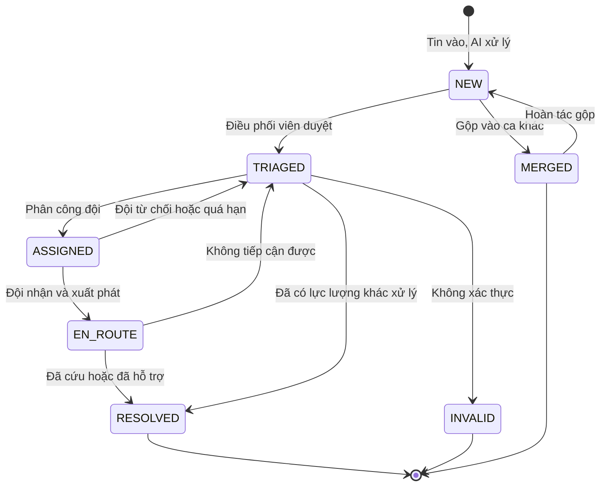

# 02 — Phạm vi V1 & Quy tắc nghiệp vụ

> Trạng thái thiết kế: **TARGET V1**

Tên sản phẩm (tạm thời): **SOSLink**.

Ngôn ngữ giao diện: **tiếng Việt**, vì người dùng là người Việt và AI xử lý tin nhắn tiếng Việt. Riêng slide thuyết trình dùng tiếng Anh.

## 1. Phạm vi V1

SOSLink V1 phục vụ **một đơn vị điều phối** (một nhóm cứu hộ, một trung tâm tình nguyện) trong **một hoặc nhiều đợt thiên tai**, gồm:

- Tiếp nhận tin qua **form web công khai** và **tình nguyện viên dán tin** (văn bản hoặc ảnh chụp màn hình); Zalo OA nếu còn thời gian.
- **AI trích xuất** thông tin, định vị địa chỉ, **đề xuất gộp tin trùng** và **đề xuất mức ưu tiên**.
- Điều phối viên **duyệt ca**, phân công đội với gợi ý đội phù hợp.
- Đội cứu hộ nhận nhiệm vụ và cập nhật kết quả trên điện thoại.
- Người gửi tra cứu tình trạng bằng mã.
- Cảnh báo ca quá hạn, dashboard, báo cáo sau sự kiện, đo chất lượng AI, nhật ký.

## 2. Ngoài phạm vi

| Không làm ở V1 | Lý do |
|---|---|
| Tự động quét Facebook, nhóm Zalo | Rủi ro điều khoản nền tảng và dữ liệu cá nhân; đã có dự án làm phần này |
| Thay thế tổng đài 112 | Form luôn nhắc gọi 112 nếu nguy hiểm tức thời |
| Bản đồ công khai có thông tin người gặp nạn | Lộ dữ liệu cá nhân, dễ bị lợi dụng |
| Dẫn đường theo tình trạng ngập thực tế | Không có dữ liệu đường ngập đáng tin cậy |
| Quản lý hàng cứu trợ, kho, quyên góp | Bài toán khác, quá rộng |
| Gọi điện và chuyển giọng nói thành văn bản, SMS | Ưu tiên sau V1 |
| Tự train model AI | Dùng API mô hình có sẵn |
| Ứng dụng mobile native | Web responsive, có hàng đợi khi mất mạng ở màn hình đội |

## 3. Quy tắc nghiệp vụ

Giá trị mặc định do `ADMIN` cấu hình. Các con số là **đề xuất ban đầu**, cần chỉnh theo góp ý của đội cứu hộ thật.

### 3.1 An toàn: nhóm quy tắc quan trọng nhất

| Mã | Quy tắc |
|---|---|
| BR01 | **Không tin nào bị mất:** tin gốc được lưu nguyên trước khi xử lý. Không xóa tin; chỉ đánh dấu. |
| BR02 | **AI chỉ đề xuất:** AI không được tự phân công, đóng ca, hạ mức ưu tiên hoặc gộp ca. |
| BR03 | **Khi nghi ngờ, ưu tiên cao hơn:** AI lỗi, thiếu dữ liệu hoặc độ tin cậy dưới 0,6 → ca nhận tối thiểu mức P2 và đánh dấu `CẦN NGƯỜI ĐỌC`. |
| BR04 | **Dấu hiệu nguy hiểm chỉ nâng, không hạ:** bộ từ khóa (mái nhà, nước đang lên, trẻ sơ sinh, bất tỉnh…) chạy độc lập với AI và luôn có thể nâng mức ưu tiên. |
| BR05 | **Tin gốc luôn hiển thị** cạnh kết quả AI ở mọi màn hình duyệt. |
| BR06 | **Nội dung tin chỉ là dữ liệu:** câu lệnh nằm trong tin không được làm thay đổi hành vi AI; AI không có quyền thực hiện hành động. |
| BR07 | **Hệ thống vẫn chạy khi AI hỏng:** tin vào hàng đợi đọc tay, không dừng tiếp nhận. |

### 3.2 Mức ưu tiên

| Mức | Tên | Ví dụ | Hạn phân công (SLA) |
|---|---|---|---|
| **P1** | Nguy hiểm tính mạng tức thì | Trên mái nhà, nước đang lên; người bị thương nặng; trẻ sơ sinh mắc kẹt | 10 phút |
| **P2** | Khẩn cấp | Bị cô lập, có người già, trẻ em; sắp hết nước uống, thuốc | 30 phút |
| **P3** | Cần hỗ trợ | Cần nhu yếu phẩm, chưa nguy hiểm ngay | 2 giờ |
| **P4** | Thông tin | Báo tình hình chung, hỏi thăm người thân | Không có |

### 3.3 Gộp tin và xác minh

| Mã | Quy tắc |
|---|---|
| BR08 | **Mỗi ca gồm một hoặc nhiều tin.** Tin mới có điện thoại trùng, hoặc cách dưới 200 m và nội dung tương tự trong 24 giờ, sẽ được **đề xuất** gộp. |
| BR09 | **Gộp do người xác nhận và hoàn tác được.** Sau khi gộp vẫn xem được từng tin gốc. Ca gộp lấy mức ưu tiên cao nhất. |
| BR10 | **Tin mới vào ca đang xử lý** sẽ báo điều phối viên và đội, vì có thể chứa diễn biến mới. |
| BR11 | **Trạng thái xác minh:** `CHƯA XÁC MINH` · `ĐÃ GỌI ĐƯỢC` · `KHÔNG LIÊN LẠC ĐƯỢC`. Ca chưa xác minh **vẫn được phân công** nếu là P1; không gọi được không phải là lý do bỏ qua. |
| BR12 | **Tin có dấu hiệu cũ** (AI thấy mốc thời gian cũ) chỉ được gắn nhãn, không bị loại. |
| BR13 | Chỉ `ADMIN` hoặc điều phối viên mới đóng được ca `KHÔNG XÁC THỰC`, và phải ghi lý do. |

### 3.4 Điều phối

| Mã | Quy tắc |
|---|---|
| BR14 | **Chỉ con người phân công.** Hệ thống gợi ý theo khoảng cách đường chim bay, phương tiện và số nhiệm vụ đang làm. Gợi ý ghi rõ là không tính đến đường ngập. |
| BR15 | Đội có **5 phút** để nhận nhiệm vụ. Quá hạn hoặc từ chối → ca quay lại hàng đợi và cảnh báo. |
| BR16 | **Cảnh báo quá hạn:** quá SLA chưa có đội, hoặc đội không cập nhật sau **30 phút** → báo điều phối viên. |
| BR17 | Mọi thao tác trên ca đều ghi vào dòng thời gian của ca: ai, lúc nào, làm gì. |
| BR18 | Màn hình đội **lưu cập nhật khi mất mạng** và tự gửi lại khi có mạng. |

### 3.5 Dữ liệu cá nhân

| Mã | Quy tắc |
|---|---|
| BR19 | Trang tra cứu công khai chỉ hiện trạng thái tổng quát, **không hiện** tên, điện thoại, địa chỉ. |
| BR20 | `VOLUNTEER` chỉ xem được tin do mình nhập. `TEAM` chỉ xem được ca được giao, và chỉ trong thời gian thực hiện. |
| BR21 | Dữ liệu cá nhân được **ẩn danh sau 90 ngày** kể từ khi sự kiện kết thúc. Số liệu thống kê được giữ lại. |
| BR22 | Mọi lần xem số điện thoại, xuất dữ liệu đều ghi nhật ký. |

[Luật Bảo vệ dữ liệu cá nhân số 91/2025/QH15](https://thuvienphapluat.vn/van-ban/Bo-may-hanh-chinh/Luat-Bao-ve-du-lieu-ca-nhan-625628.aspx) có hiệu lực từ 1/1/2026 và [có ngoại lệ cho tình thế nguy cấp để bảo vệ tính mạng](https://luatvietnam.vn/tin-van-ban-moi/5-truong-hop-xu-ly-du-lieu-ca-nhan-khong-can-su-dong-y-cua-chu-the-186-103746-article.html). **Nhóm chưa có tư vấn pháp lý**, nên cần đối chiếu nguyên văn Điều 19 trước khi triển khai thật.

## 4. Vòng đời của một ca



| Trạng thái | Hiển thị | Ý nghĩa |
|---|---|---|
| `NEW` | Chờ duyệt | AI đã xử lý hoặc chờ người đọc |
| `TRIAGED` | Chờ phân công | Đã duyệt, vào hàng đợi theo ưu tiên |
| `ASSIGNED` | Chờ đội nhận | Đã giao, đang chờ đội xác nhận |
| `EN_ROUTE` | Đang đến | Đội đã nhận và xuất phát |
| `RESOLVED` | Đã xử lý | Có kết quả: số người được cứu, ghi chú |
| `INVALID` | Không xác thực | Tin giả hoặc nhầm, có lý do |
| `MERGED` | Đã gộp | Trỏ tới ca chính |

## 5. Đầu ra AI

```json
{
  "isRescueRequest": true,
  "address": { "raw": "gần cầu Sông Ba, thôn 3, Hòa Thịnh", "commune": "Hòa Thịnh", "landmark": "cầu Sông Ba" },
  "phones": ["09xxxxx234"],
  "peopleCount": 3,
  "vulnerable": ["ELDERLY", "INFANT"],
  "situation": "Nước ngập đến mái nhà",
  "needs": ["RESCUE"],
  "dangerSignals": ["ON_ROOF", "INFANT"],
  "suggestedPriority": "P1",
  "reason": "Nước tới mái, có trẻ 8 tháng và 2 người già",
  "possiblyOld": false,
  "confidence": 0.86
}
```

Trường nào AI không chắc thì để `null`; **không được đoán** địa chỉ hay số điện thoại.

## 6. Nguồn dữ liệu

| Loại | Nguồn | Ghi chú |
|---|---|---|
| Tin khi vận hành | Form web, tình nguyện viên dán tin, Zalo OA | Kênh hệ thống được phép nhận |
| Bộ đánh giá | 100–200 bài công khai thu thập tay, xóa tên và số điện thoại | Gán nhãn thủ công |
| Bộ demo | Tin giả lập do nhóm tạo, ghi rõ là giả lập | Có viết tắt, không dấu, tin trùng, tin giả, tin cũ |
| Địa giới hành chính | Danh mục xã, phường sau sáp nhập | Phải dùng dữ liệu mới |
| Bản đồ, định vị | OpenStreetMap hoặc Goong | **Rủi ro lớn nhất:** địa chỉ nông thôn rất mơ hồ, nên cho phép ghim tay trên bản đồ |
| Đội cứu hộ | Dữ liệu mẫu | Thay bằng dữ liệu thật khi triển khai |

## 7. Rủi ro chính

| Rủi ro | Mức | Giảm thiểu |
|---|---|---|
| AI đánh giá thấp một ca nguy hiểm | Rất cao | BR02–BR05; đo recall P1; không tự hạ mức |
| Địa chỉ sai khiến đội đi nhầm | Cao | Hiện độ tin cậy, tin gốc, ghim tay; gọi xác minh |
| Không đội nào chịu nhập liệu khi đang cứu | Cao | Chỉ 2–3 nút lớn; điều phối viên cập nhật hộ qua điện thoại |
| Mất mạng ở vùng lũ | Cao | Hàng đợi khi mất mạng; kênh liên lạc ngoài hệ thống vẫn là dự phòng |
| Lộ thông tin người gặp nạn | Cao | BR19–BR22 |
| Tin giả làm lãng phí lực lượng | Trung bình | Trạng thái xác minh, số người báo cùng ca |
| Chưa có nhóm cứu hộ thật dùng thử | Trung bình | Phỏng vấn sớm, diễn tập bằng bộ tin phát lại |

---

**Liên quan:** [Research](01-research.md) · [Use cases](03-use-cases.md)
