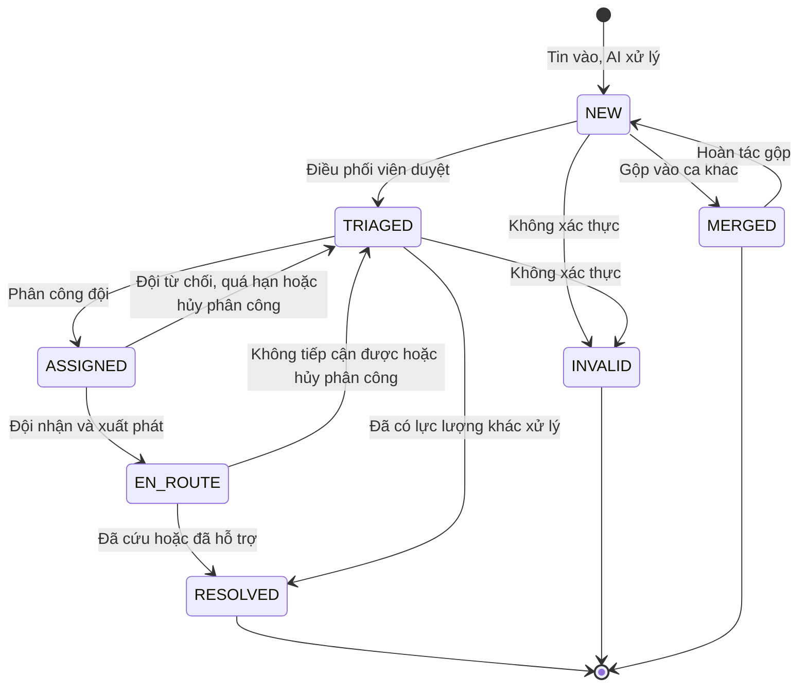

# 02 — V1 Scope & Business Rules

> Design status: **TARGET V1**

Product name (provisional): **SOSLink**.

Interface language: **Vietnamese**, because the users are Vietnamese and the AI processes Vietnamese messages. Documentation and presentation slides are in English.

## 1. V1 scope

SOSLink V1 serves **one coordinating unit** (a rescue group, a volunteer centre) across **one or more disaster events**, and includes:

- Receiving messages through a **public web form** and **volunteers pasting messages** (text or screenshots); Zalo OA if time allows.
- **AI extraction**, geocoding, **duplicate suggestions** and **priority suggestions**.
- Coordinators **review cases** and assign teams with team suggestions.
- Rescue teams receive missions and report outcomes on their phones.
- Senders look up status with a code.
- Overdue alerts, dashboard, after-action report, AI quality measurement, audit log.

## 2. Out of scope

| Not in V1 | Reason |
|---|---|
| Automatically scanning Facebook and Zalo groups | Platform terms and personal data risks; other projects already do this |
| Replacing the 112 hotline | The form always reminds people to call 112 in immediate danger |
| Public map with information about people in danger | Exposes personal data, easy to abuse |
| Routing around actual flooded roads | No reliable flooded-road data |
| Managing relief goods, warehouses, donations | A different and much wider problem |
| Phone calls with speech-to-text, SMS | Priority after V1 |
| Training a custom AI model | Uses an existing model API |
| Native mobile app | Responsive web with an offline queue on the team screens |

## 3. Business rules

Defaults are configured by `ADMIN`. The numbers are **initial proposals**, to be adjusted with feedback from real rescue teams.

### 3.1 Safety: the most important rules

| Code | Rule |
|---|---|
| BR01 | **No message is ever lost:** the original is saved intact before any processing. Messages are never deleted, only flagged. |
| BR02 | **AI only suggests:** AI must not assign teams, close cases, lower priority or merge cases on its own. |
| BR03 | **When in doubt, go higher:** AI failure, missing data or confidence below 0.6 → the case gets at least P2 and is flagged `CẦN NGƯỜI ĐỌC` (needs a human read). |
| BR04 | **Danger signals only raise, never lower:** the keyword set (roof, rising water, newborn, unconscious…) runs independently of AI and can always raise priority. |
| BR05 | **The original message is always shown** next to the AI result on every review screen. |
| BR06 | **Message content is only data:** instructions inside a message must not change AI behaviour; AI has no permission to perform actions. |
| BR07 | **The system keeps running when AI fails:** messages go to a manual reading queue; intake does not stop. |

### 3.2 Priority levels

| Level | Name | Examples | Assignment deadline (SLA) |
|---|---|---|---|
| **P1** | Immediate danger to life | On a roof with water rising; seriously injured; trapped newborn | 10 minutes |
| **P2** | Urgent | Isolated, with elderly people or children; running out of water or medicine | 30 minutes |
| **P3** | Needs support | Needs supplies, no immediate danger | 2 hours |
| **P4** | Information | General situation reports, asking about relatives | None |

### 3.3 Merging and verification

| Code | Rule |
|---|---|
| BR08 | **Each case has one or more messages.** A new message with a matching phone number, or less than 200 m away with similar content within 24 hours, is **suggested** for merging. |
| BR09 | **Merging is confirmed by a person and can be undone.** Each original message stays viewable after merging. The merged case takes the highest priority. |
| BR10 | **A new message on a case in progress** notifies the coordinator and the team, because it may contain new developments. |
| BR11 | **Verification states:** `CHƯA XÁC MINH` (unverified) · `ĐÃ GỌI ĐƯỢC` (reached) · `KHÔNG LIÊN LẠC ĐƯỢC` (unreachable). An unverified P1 case **can still be assigned**; being unreachable is not a reason to skip it. |
| BR12 | **Messages that look old** (AI sees an old time reference) are only labelled, not removed. |
| BR13 | Only `ADMIN` or a coordinator can close a case as `KHÔNG XÁC THỰC` (not verified), and must give a reason. |

### 3.4 Dispatch

| Code | Rule |
|---|---|
| BR14 | **Only people assign.** The system suggests by straight-line distance, vehicle and number of active missions. Suggestions state clearly that flooded roads are not considered. |
| BR15 | A team has **5 minutes** to accept a mission. Timeout or decline → the case returns to the queue and raises an alert. |
| BR16 | **Overdue alerts:** past SLA with no team, or a team with no update for **30 minutes** → notify the coordinator. |
| BR17 | Every action on a case is written to its timeline: who, when, what. |
| BR18 | The team screen **saves updates while offline** and resends them when back online. |

### 3.5 Personal data

| Code | Rule |
|---|---|
| BR19 | The public lookup page shows only general status and **does not show** name, phone or address. |
| BR20 | `VOLUNTEER` sees only messages they entered. `TEAM` sees only assigned cases, and only while the mission is running. |
| BR21 | Personal data is **anonymised 90 days** after the event ends. Statistics are kept. |
| BR22 | Every phone number view and data export is logged. |

[Personal Data Protection Law No. 91/2025/QH15](https://thuvienphapluat.vn/van-ban/Bo-may-hanh-chinh/Luat-Bao-ve-du-lieu-ca-nhan-625628.aspx) takes effect on 1/1/2026 and [has an exception for emergencies to protect life](https://luatvietnam.vn/tin-van-ban-moi/5-truong-hop-xu-ly-du-lieu-ca-nhan-khong-can-su-dong-y-cua-chu-the-186-103746-article.html). **I have no legal advice yet**, so the original text of Article 19 needs checking before any real deployment.

## 4. Case lifecycle



| Status | Shown as | Meaning |
|---|---|---|
| `NEW` | Chờ duyệt | AI has processed it, or it is waiting for a human read |
| `TRIAGED` | Chờ phân công | Reviewed, in the priority queue |
| `ASSIGNED` | Chờ đội nhận | Assigned, waiting for the team to confirm |
| `EN_ROUTE` | Đang đến | Team has accepted and set off |
| `RESOLVED` | Đã xử lý | Has an outcome: people rescued, notes |
| `INVALID` | Không xác thực | Fake or mistaken, with a reason |
| `MERGED` | Đã gộp | Points to the main case |

## 5. AI output

```json
{
  "isRescueRequest": true,
  "address": { "raw": "gần cầu Sông Ba, thôn 3, Hòa Thịnh", "commune": "Hòa Thịnh", "landmark": "cầu Sông Ba" },
  "phones": ["09xxxxx234"],
  "peopleCount": 3,
  "vulnerable": ["ELDERLY", "INFANT"],
  "situation": "Nước ngập đến mái nhà",
  "needs": ["RESCUE"],
  "dangerSignals": ["ON_ROOF", "INFANT"],
  "suggestedPriority": "P1",
  "reason": "Nước tới mái, có trẻ 8 tháng và 2 người già",
  "possiblyOld": false,
  "confidence": 0.86
}
```

Any field the AI is unsure about is `null`; it **must not guess** an address or phone number.

## 6. Data sources

| Type | Source | Notes |
|---|---|---|
| Messages in operation | Web form, volunteers pasting messages, Zalo OA | Channels the system is allowed to receive |
| Evaluation set | 100–200 public posts collected by hand, names and phone numbers removed | Labelled by hand |
| Demo set | Simulated messages I create, clearly marked as simulated | Includes abbreviations, missing diacritics, duplicates, fake and old messages |
| Administrative units | List of communes and wards after the merger | Must use current data |
| Maps, geocoding | OpenStreetMap or Goong | **Biggest risk:** rural addresses are very vague, so manual map pinning is allowed |
| Rescue teams | Sample data | Replace with real data on deployment |

## 7. Main risks

| Risk | Level | Mitigation |
|---|---|---|
| AI underrates a dangerous case | Very high | BR02–BR05; measure P1 recall; no automatic lowering |
| Wrong address sends a team astray | High | Show confidence and original message, manual pin, verification call |
| No team is willing to enter data during a rescue | High | Only 2–3 large buttons; coordinator can update on their behalf by phone |
| No network in flood zones | High | Offline queue; communication outside the system remains the backup |
| Exposure of information about people in danger | High | BR19–BR22 |
| Fake messages waste resources | Medium | Verification status, number of people reporting the same case |
| No real rescue group trying it yet | Medium | Early interviews, drills with a replayed message set |

---

**Related:** [Research](01-research.md) · [Use cases](03-use-cases.md)
