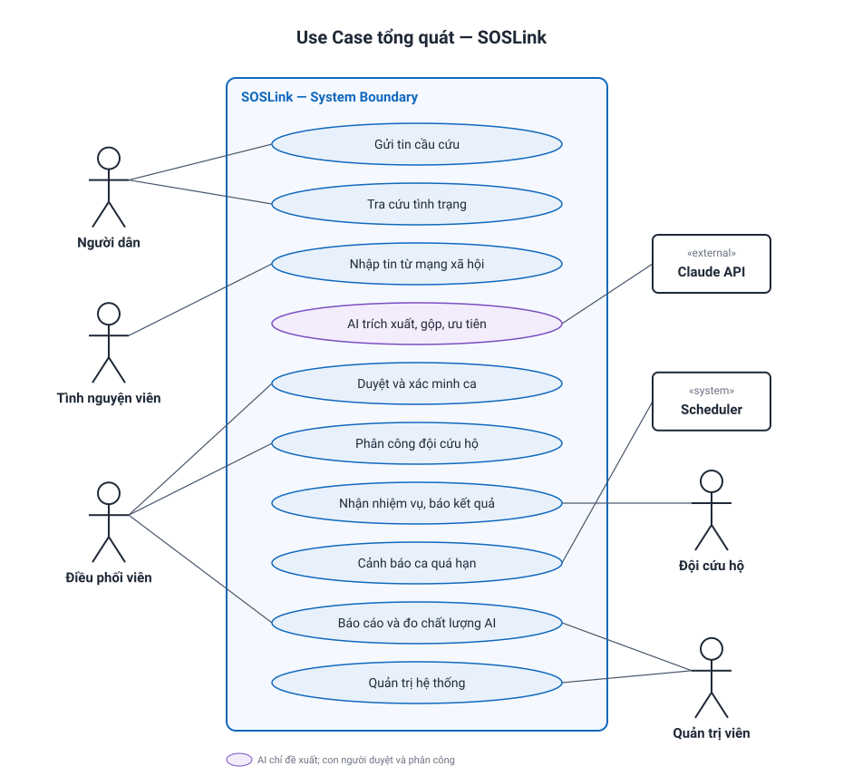

# 03 — Tác nhân, Vai trò, Phân quyền & Use Case

> Trạng thái thiết kế: **TARGET V1**

## 1. Tác nhân

| Mã | Tên hiển thị | Loại | Giao diện |
|---|---|---|---|
| — | Người dân (người gặp nạn, người thân) | Không cần tài khoản | Trang công khai, mobile-first |
| `VOLUNTEER` | Tình nguyện viên trực tin | Người dùng | Màn hình nhập tin |
| `COORDINATOR` | Điều phối viên | Người dùng | Trung tâm điều phối |
| `TEAM` | Đội trưởng đội cứu hộ | Người dùng | Màn hình nhiệm vụ trên điện thoại |
| `ADMIN` | Quản trị viên / trưởng nhóm | Người dùng | Trung tâm điều phối + Quản trị |
| `SYSTEM` | Scheduler | Tự động | Không có |
| `AI` | Claude API | Hệ thống ngoài | Không có |

Mỗi tài khoản có đúng một vai trò. `ADMIN` có toàn bộ quyền của `COORDINATOR`.

## 2. Ma trận phân quyền

| Chức năng | Người dân | VOLUNTEER | COORDINATOR | TEAM | ADMIN |
|---|:---:|:---:|:---:|:---:|:---:|
| Gửi tin qua form công khai | ✓ | | | | |
| Tra cứu bằng mã (chỉ trạng thái tổng quát) | ✓ | | | | |
| Đăng nhập, hồ sơ cá nhân | | ✓ | ✓ | ✓ | ✓ |
| Dán tin / ảnh chụp màn hình | | ✓ | ✓ | | ✓ |
| Xem tin | | Tin của mình | Tất cả | Tin của ca được giao | Tất cả |
| Duyệt, sửa, đổi ưu tiên | | | ✓ | | ✓ |
| Xác nhận hoặc hoàn tác gộp tin | | | ✓ | | ✓ |
| Ghi nhận cuộc gọi xác minh | | Tin của mình | ✓ | | ✓ |
| Xem bản đồ điều phối | | | ✓ | | ✓ |
| Phân công đội | | | ✓ | | ✓ |
| Đánh dấu ca không xác thực | | | ✓ (có lý do) | | ✓ |
| Nhận, từ chối nhiệm vụ, báo kết quả | | | | Ca của đội | |
| Cập nhật hộ đội (qua điện thoại) | | | ✓ | | ✓ |
| Báo cáo, dashboard | | | ✓ | | ✓ |
| Chất lượng AI, nhật ký, xuất dữ liệu | | | | | ✓ |
| Quản lý tài khoản, đội, đợt thiên tai, cấu hình | | | | | ✓ |

Backend kiểm tra quyền trên mọi API; `TEAM` mất quyền xem thông tin cá nhân của ca khi nhiệm vụ kết thúc (BR20).

## 3. Use Case Diagram tổng quát

Sơ đồ chỉ thể hiện các tính năng chính. Danh sách đầy đủ ở mục 4.

## 4. Danh sách Use Case

| ID | Use case | Tác nhân | Phân hệ |
|---|---|---|---|
| UC01 | Đăng nhập, đăng xuất | VOLUNTEER, COORDINATOR, TEAM, ADMIN | M1 |
| UC02 | Quản lý hồ sơ, đổi mật khẩu | VOLUNTEER, COORDINATOR, TEAM, ADMIN | M1 |
| UC03 | Gửi tin cầu cứu qua form | Người dân | M2 |
| UC04 | Tra cứu tình trạng bằng mã | Người dân | M2 |
| UC05 | Nhập tin từ mạng xã hội (dán chữ, ảnh) | VOLUNTEER, COORDINATOR | M2 |
| UC06 | Nhận tin từ Zalo OA | SYSTEM | M2 |
| UC07 | AI trích xuất thông tin | AI | M3 |
| UC08 | Định vị địa chỉ | SYSTEM | M3 |
| UC09 | Đề xuất gộp tin trùng | AI, SYSTEM | M3 |
| UC10 | Đề xuất mức ưu tiên | AI, SYSTEM | M3 |
| UC11 | Duyệt và sửa ca | COORDINATOR | M4 |
| UC12 | Xác nhận, hoàn tác gộp tin | COORDINATOR | M4 |
| UC13 | Ghi nhận xác minh | VOLUNTEER, COORDINATOR | M4 |
| UC14 | Xem bản đồ và hàng đợi điều phối | COORDINATOR | M5 |
| UC15 | Phân công đội cứu hộ | COORDINATOR | M5 |
| UC16 | Cảnh báo ca quá hạn | SYSTEM | M5 |
| UC17 | Nhận hoặc từ chối nhiệm vụ | TEAM | M6 |
| UC18 | Cập nhật tiến độ, báo kết quả | TEAM, COORDINATOR | M6 |
| UC19 | Xem dashboard, báo cáo sau sự kiện | COORDINATOR, ADMIN | M7 |
| UC20 | Đo chất lượng AI | ADMIN | M7 |
| UC21 | Quản lý tài khoản | ADMIN | M8 |
| UC22 | Quản lý đội cứu hộ | ADMIN | M8 |
| UC23 | Quản lý đợt thiên tai và cấu hình | ADMIN | M8 |
| UC24 | Xem nhật ký, ẩn danh dữ liệu | ADMIN, SYSTEM | M8 |

**Quan hệ chính:**
- **UC03, UC05, UC06 `«include»` UC07:** mọi tin đều qua AI, và lỗi AI không chặn việc nhận tin (BR07).
- **UC11 `«include»` UC10:** ưu tiên do AI đề xuất luôn được người xem lại.
- **UC12 `«extend»` UC11:** chỉ xảy ra khi có đề xuất gộp.

## 5. Đặc tả use case trọng tâm

### UC05 + UC07–UC10 — Từ tin lộn xộn thành ca chờ duyệt

| Mục | Nội dung |
|---|---|
| Tác nhân | VOLUNTEER; AI; Dịch vụ định vị |
| Tiền điều kiện | Có đợt thiên tai đang mở |
| Hậu điều kiện | Tin gốc được lưu; có một ca `NEW` hoặc đề xuất gộp vào ca đã có |

**Luồng chính**
1. Tình nguyện viên dán nội dung hoặc tải ảnh chụp, kèm link bài gốc nếu có.
2. Hệ thống **lưu tin gốc ngay**, rồi xử lý bất đồng bộ; tình nguyện viên có thể nhập tin tiếp.
3. AI trả về thông tin có cấu trúc, mức ưu tiên đề xuất, lý do, độ tin cậy.
4. Bộ từ khóa nguy hiểm chạy độc lập và có thể nâng mức ưu tiên.
5. Hệ thống định vị địa chỉ và tìm ca có khả năng trùng.
6. Ca xuất hiện trong hàng đợi duyệt theo mức ưu tiên.

**Ngoại lệ**
- 3a. AI lỗi hoặc quá 30 giây → ca nhận mức P2, nhãn `CẦN NGƯỜI ĐỌC`, thử lại ở nền.
- 3b. Độ tin cậy dưới 0,6 → tối thiểu P2, nhãn `CẦN NGƯỜI ĐỌC`.
- 3c. AI nhận định không phải tin cầu cứu → vẫn vào hàng đợi với nhãn `CÓ THỂ KHÔNG PHẢI CẦU CỨU`, chỉ người mới loại được.
- 5a. Không định vị được → ca vẫn vào hàng đợi với nhãn `CHƯA CÓ VỊ TRÍ`, chờ gọi xác minh hoặc ghim tay.

### UC11 + UC12 — Duyệt ca

1. Điều phối viên mở ca: tin gốc bên trái, thông tin AI trích xuất bên phải.
2. Sửa thông tin, đổi mức ưu tiên hoặc ghim lại vị trí. Hệ thống lưu giá trị AI và giá trị người chốt để đo chất lượng (UC20).
3. Nếu có đề xuất trùng: xem hai tin cạnh nhau, chọn **Gộp** hoặc **Không phải trùng**.
4. Bấm **Duyệt** → ca chuyển sang `TRIAGED`.

### UC15 — Phân công đội

1. Điều phối viên chọn ca trong hàng đợi. Hệ thống gợi ý tối đa 3 đội theo khoảng cách, phương tiện và số nhiệm vụ đang làm.
2. Điều phối viên chọn đội và bấm **Phân công** → ca sang `ASSIGNED`, đội nhận thông báo.
3. Đội nhận trong 5 phút → `EN_ROUTE`. Từ chối hoặc quá hạn → quay lại `TRIAGED`, cảnh báo điều phối viên.

### UC18 — Báo kết quả

1. Đội trưởng chọn: **Đã cứu** (nhập số người), **Đã có người khác cứu**, **Không tiếp cận được** hoặc **Không tìm thấy**.
2. Kết quả **Không tiếp cận được** đưa ca về hàng đợi và cảnh báo; các kết quả còn lại kết thúc nhiệm vụ.
3. Khi mất mạng, cập nhật được lưu trên máy và tự gửi lại.
4. Điều phối viên có thể cập nhật hộ khi đội báo qua điện thoại; dòng thời gian ghi rõ người nhập.

---

**Liên quan:** [User stories](04-user-stories.md) · [Phạm vi & quy tắc](02-scope.md) · [Information architecture](05-information-architecture.md)
