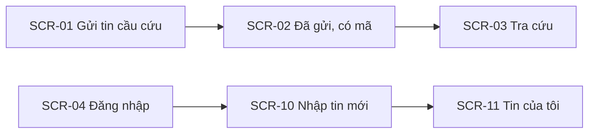
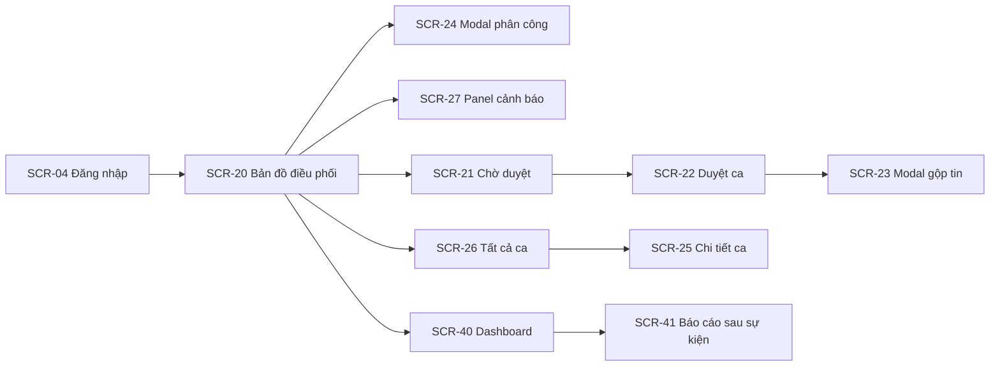
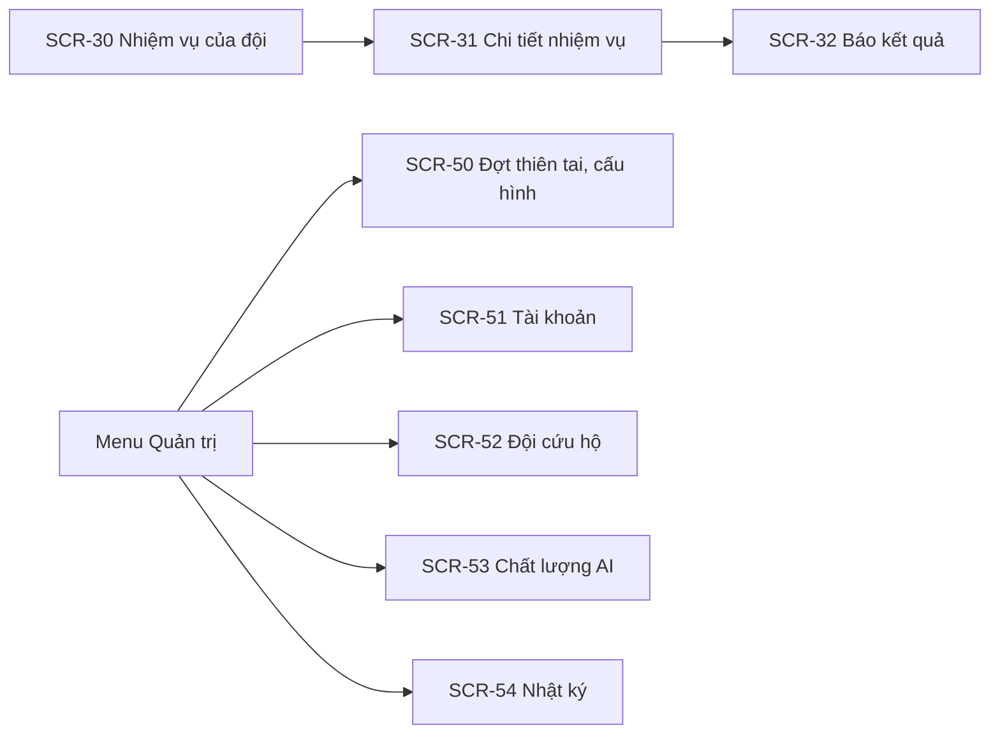
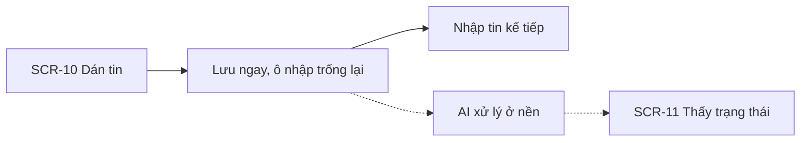
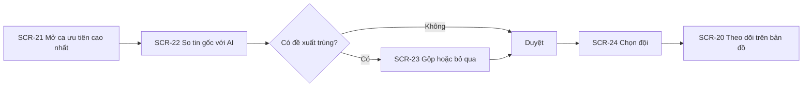
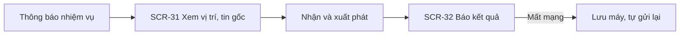

# 05 — Information Architecture & Screen Hierarchy

> Trạng thái thiết kế: **TARGET V1**

SOSLink có **4 giao diện** cho 4 hoàn cảnh sử dụng rất khác nhau, dùng chung một backend:

| Giao diện | Người dùng | Bố cục | Thiết bị, hoàn cảnh |
|---|---|---|---|
| **Trang công khai** | Người dân | Một cột, rất nhẹ, không cần đăng nhập | Điện thoại, mạng yếu, đang hoảng loạn |
| **Nhập tin** | Tình nguyện viên | Một màn hình tối giản | Laptop hoặc điện thoại, thao tác lặp lại liên tục |
| **Trung tâm điều phối** | Điều phối viên, Quản trị viên | Toàn màn hình: bản đồ + hàng đợi | Màn hình lớn, trực nhiều giờ |
| **Nhiệm vụ** | Đội trưởng | Một cột, nút lớn, hỗ trợ mất mạng | Điện thoại ngoài trời, tay ướt |

Sau khi đăng nhập, hệ thống điều hướng theo vai trò: `VOLUNTEER` → `/intake`, `COORDINATOR`/`ADMIN` → `/command`, `TEAM` → `/team`. Vào sai giao diện → `403`.

## 1. Cây Information Architecture

```text
SOSLink
│
├── Trang công khai (không cần đăng nhập)
│   ├── Gửi tin cầu cứu
│   │   └── Đã gửi: hiện mã tra cứu
│   └── Tra cứu tình trạng bằng mã
│
├── Tài khoản
│   ├── Đăng nhập
│   ├── Kích hoạt tài khoản (link mời)
│   └── Hồ sơ cá nhân
│
├── Nhập tin (VOLUNTEER)
│   ├── Nhập tin mới (dán chữ, tải ảnh)
│   └── Tin của tôi (trạng thái xử lý, ghi xác minh)
│
├── Trung tâm điều phối (COORDINATOR, ADMIN)
│   ├── Bản đồ điều phối (bản đồ · hàng đợi · đội)
│   │   ├── Phân công đội (modal)
│   │   └── Cảnh báo (panel)
│   ├── Chờ duyệt (hàng đợi theo ưu tiên)
│   │   └── Duyệt ca (tin gốc · kết quả AI · vị trí)
│   │       └── So sánh gộp tin (modal)
│   ├── Tất cả ca
│   │   └── Chi tiết ca (thông tin · các tin gốc · dòng thời gian)
│   └── Báo cáo
│       ├── Dashboard theo đợt
│       └── Báo cáo sau sự kiện
│
├── Nhiệm vụ (TEAM)
│   ├── Nhiệm vụ của đội
│   └── Chi tiết nhiệm vụ
│       └── Báo kết quả (bottom sheet)
│
├── Quản trị (ADMIN)
│   ├── Đợt thiên tai và cấu hình
│   ├── Tài khoản
│   ├── Đội cứu hộ
│   ├── Chất lượng AI
│   └── Nhật ký
│
└── Hệ thống: 403 · 404
```

## 2. Screen Hierarchy

### 2.1 Trang công khai và Nhập tin



### 2.2 Trung tâm điều phối



### 2.3 Nhiệm vụ và Quản trị



## 3. Danh sách màn hình

| Screen ID | Màn hình | Kiểu | Vai trò | Stories |
|---|---|---|---|---|
| `SCR-01` | Gửi tin cầu cứu | Page | Công khai | US03 |
| `SCR-02` | Đã gửi, hiện mã | Page | Công khai | US03 |
| `SCR-03` | Tra cứu tình trạng | Page | Công khai | US04 |
| `SCR-04` | Đăng nhập | Page | Công khai | US01 |
| `SCR-05` | Kích hoạt tài khoản | Page | Có link mời | US21 |
| `SCR-06` | Hồ sơ cá nhân | Page | Nội bộ | US02 |
| `SCR-10` | Nhập tin mới | Page | VOLUNTEER, COORDINATOR, ADMIN | US05 |
| `SCR-11` | Tin của tôi | Page | VOLUNTEER | US05, US13 |
| `SCR-20` | Bản đồ điều phối | Page | COORDINATOR, ADMIN | US08, US14 |
| `SCR-21` | Chờ duyệt | Page | COORDINATOR, ADMIN | US10, US11 |
| `SCR-22` | Duyệt ca | Page | COORDINATOR, ADMIN | US07–US11, US13 |
| `SCR-23` | So sánh gộp tin | Modal | COORDINATOR, ADMIN | US09, US12 |
| `SCR-24` | Phân công đội | Modal | COORDINATOR, ADMIN | US15 |
| `SCR-25` | Chi tiết ca | Page | COORDINATOR, ADMIN | US12, US18 |
| `SCR-26` | Tất cả ca | Page | COORDINATOR, ADMIN | US14 |
| `SCR-27` | Cảnh báo | Panel | COORDINATOR, ADMIN | US16 |
| `SCR-30` | Nhiệm vụ của đội | Page | TEAM | US17 |
| `SCR-31` | Chi tiết nhiệm vụ | Page | TEAM | US17 |
| `SCR-32` | Báo kết quả | Bottom sheet | TEAM | US18 |
| `SCR-40` | Dashboard theo đợt | Page | COORDINATOR, ADMIN | US19 |
| `SCR-41` | Báo cáo sau sự kiện | Page | COORDINATOR, ADMIN | US19 |
| `SCR-50` | Đợt thiên tai, cấu hình | Page | ADMIN | US23 |
| `SCR-51` | Tài khoản | Page + modal | ADMIN | US21 |
| `SCR-52` | Đội cứu hộ | Page + modal | ADMIN | US22 |
| `SCR-53` | Chất lượng AI | Page | ADMIN | US20 |
| `SCR-54` | Nhật ký | Page | ADMIN | US24 |
| `SCR-90` · `SCR-91` | 403 · 404 | Page | Tất cả | — |

**Tổng: 28 màn hình.** US06 (Zalo OA) không có màn hình riêng: tin xuất hiện trong `SCR-21` với nhãn kênh.

## 4. Routes

| Route | Screen |
|---|---|
| `/sos` · `/sos/sent/:code` · `/track` | SCR-01 · SCR-02 · SCR-03 |
| `/login` · `/activate?token=` · `/profile` | SCR-04 · SCR-05 · SCR-06 |
| `/intake` · `/intake/mine` | SCR-10 · SCR-11 |
| `/command` | SCR-20 |
| `/command/review` · `/command/review/:caseId` | SCR-21 · SCR-22 |
| `/command/cases` · `/command/cases/:caseId` | SCR-26 · SCR-25 |
| `/team` · `/team/missions/:id` | SCR-30 · SCR-31 |
| `/reports` · `/reports/:eventId` | SCR-40 · SCR-41 |
| `/admin/events` · `/admin/users` · `/admin/teams` · `/admin/ai-quality` · `/admin/audit` | SCR-50 → SCR-54 |
| `/403` · `*` | SCR-90 · SCR-91 |

## 5. Điều hướng

**Trung tâm điều phối:** thanh trái thu gọn thành biểu tượng để nhường chỗ cho bản đồ.

| Mục | COORDINATOR | ADMIN |
|---|:---:|:---:|
| Bản đồ điều phối | ✓ | ✓ |
| Chờ duyệt (badge số ca) | ✓ | ✓ |
| Tất cả ca | ✓ | ✓ |
| Nhập tin | ✓ | ✓ |
| Báo cáo | ✓ | ✓ |
| Quản trị | | ✓ |

Thanh trên luôn hiện: **đợt thiên tai đang chọn**, số ca P1 chưa có đội, chuông cảnh báo, trạng thái kết nối. Mục không có quyền **không được render**.

**Trang công khai:** không có menu. Số **112** luôn hiện ở đầu trang.

**Nhiệm vụ:** không có menu; chỉ một danh sách, nhiệm vụ đang làm luôn nằm trên cùng.

## 6. Luồng người dùng chính

### 6.1 Tình nguyện viên nhập tin



### 6.2 Điều phối viên xử lý một ca



### 6.3 Đội cứu hộ



## 7. Trạng thái màn hình

| Trạng thái | Hiển thị |
|---|---|
| Loading | Skeleton; bản đồ giữ dữ liệu cũ kèm nhãn thời gian |
| Rỗng (hàng đợi) | "Không còn ca chờ duyệt" |
| AI đang xử lý | Ca hiện nhãn "AI đang đọc", nhưng **vẫn mở và duyệt được** bằng tin gốc |
| AI lỗi | Nhãn "CẦN NGƯỜI ĐỌC", mức tối thiểu P2 |
| Chưa có vị trí | Ca nằm ở mục riêng "Chưa có vị trí" trong hàng đợi, không biến mất khỏi bản đồ |
| Mất kết nối (điều phối) | Banner đỏ "Dữ liệu dừng cập nhật lúc HH:mm"; khóa nút phân công |
| Mất mạng (đội, form) | Banner "Đã lưu, sẽ gửi khi có mạng" |
| Xung đột | "Ca này vừa được Lan phân công cho Đội 3" + tải lại |
| Không có quyền | Trang 403 |

## 8. Ánh xạ Story → Màn hình

| Story | Màn hình chính |
|---|---|
| US01 · US02 | SCR-04 · SCR-06 |
| US03 · US04 | SCR-01, SCR-02 · SCR-03 |
| US05 · US06 | SCR-10, SCR-11 · hiện trong SCR-21 |
| US07 · US08 · US10 · US11 | SCR-22 |
| US09 · US12 | SCR-22 → SCR-23 |
| US13 | SCR-22, SCR-11 |
| US14 · US15 · US16 | SCR-20 · SCR-24 · SCR-27 |
| US17 · US18 | SCR-30, SCR-31 · SCR-32 |
| US19 · US20 | SCR-40, SCR-41 · SCR-53 |
| US21 · US22 · US23 · US24 | SCR-51 · SCR-52 · SCR-50 · SCR-54 |

---

**Liên quan:** [Use cases](03-use-cases.md) · [User stories](04-user-stories.md) · [UI/UX](06-ui-ux.md)
