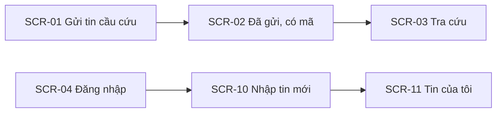
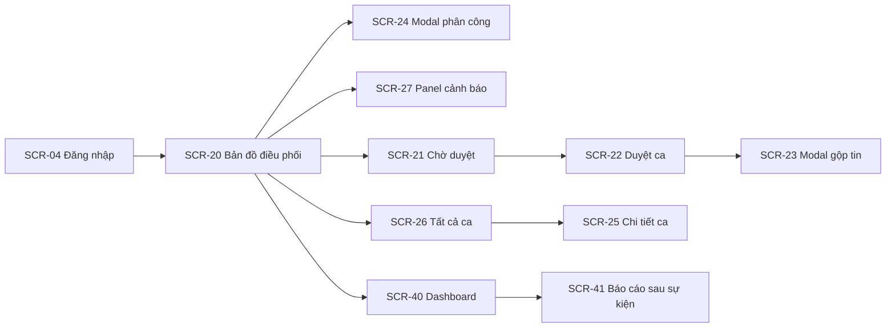
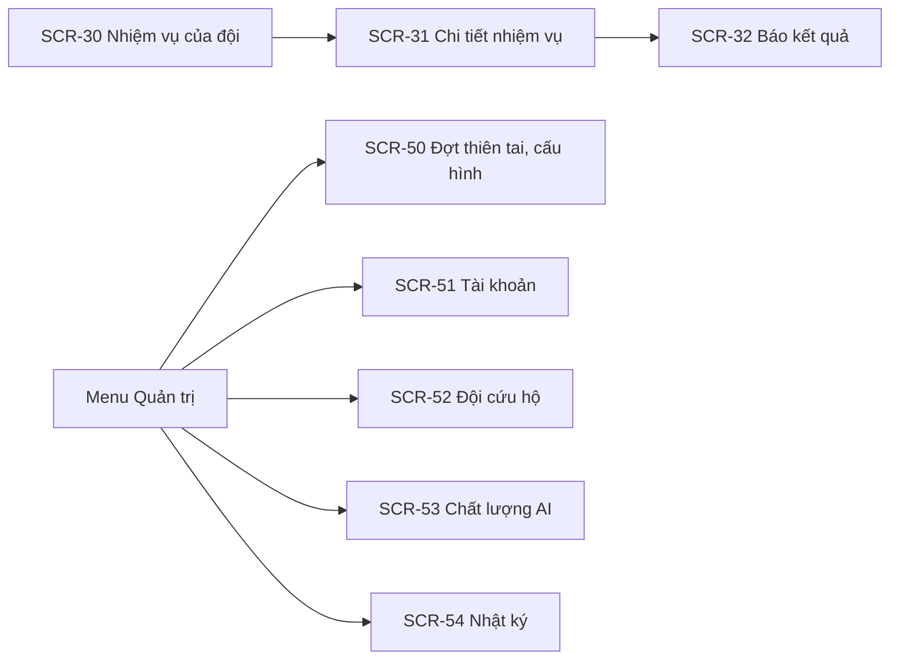
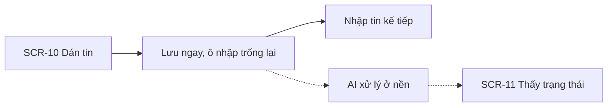
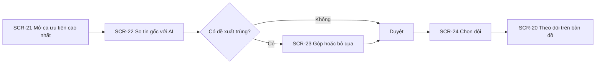
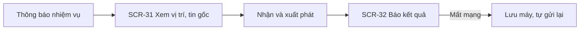

# 05 — Information Architecture & Screen Hierarchy

> Design status: **TARGET V1**

SOSLink has **4 interfaces** for 4 very different situations, sharing one backend:

| Interface | Users | Layout | Device, situation |
|---|---|---|---|
| **Public pages** | Residents | One column, very light, no login | Phone, weak network, panicking |
| **Intake** | Volunteers | One minimal screen | Laptop or phone, constantly repeated actions |
| **Command centre** | Coordinators, Administrators | Full screen: map + queue | Large screen, long shifts |
| **Missions** | Team leaders | One column, large buttons, offline support | Phone outdoors, wet hands |

After login, the system routes by role: `VOLUNTEER` → `/intake`, `COORDINATOR`/`ADMIN` → `/command`, `TEAM` → `/team`. Wrong interface → `403`.

## 1. Information architecture tree

```text
SOSLink
│
├── Public pages (no login)
│   ├── Send a call for help
│   │   └── Sent: shows tracking code
│   └── Look up status by code
│
├── Account
│   ├── Log in
│   ├── Activate account (invitation link)
│   └── Personal profile
│
├── Intake (VOLUNTEER)
│   ├── New message (paste text, upload images)
│   └── My messages (processing status, record verification)
│
├── Command centre (COORDINATOR, ADMIN)
│   ├── Command map (map · queue · teams)
│   │   ├── Assign team (modal)
│   │   └── Alerts (panel)
│   ├── Awaiting review (queue by priority)
│   │   └── Review case (original message · AI result · location)
│   │       └── Compare and merge (modal)
│   ├── All cases
│   │   └── Case detail (information · original messages · timeline)
│   └── Reports
│       ├── Event dashboard
│       └── After-action report
│
├── Missions (TEAM)
│   ├── Team missions
│   └── Mission detail
│       └── Report outcome (bottom sheet)
│
├── Administration (ADMIN)
│   ├── Disaster events and configuration
│   ├── Accounts
│   ├── Rescue teams
│   ├── AI quality
│   └── Audit log
│
└── System: 403 · 404
```

## 2. Screen hierarchy

### 2.1 Public pages and Intake



### 2.2 Command centre



### 2.3 Missions and Administration



## 3. Screen list

| Screen ID | Screen | Type | Role | Stories |
|---|---|---|---|---|
| `SCR-01` | Send call for help | Page | Public | US03 |
| `SCR-02` | Sent, shows code | Page | Public | US03 |
| `SCR-03` | Look up status | Page | Public | US04 |
| `SCR-04` | Log in | Page | Public | US01 |
| `SCR-05` | Activate account | Page | Has invitation link | US21 |
| `SCR-06` | Personal profile | Page | Internal | US02 |
| `SCR-10` | New message | Page | VOLUNTEER, COORDINATOR, ADMIN | US05 |
| `SCR-11` | My messages | Page | VOLUNTEER | US05, US13 |
| `SCR-20` | Command map | Page | COORDINATOR, ADMIN | US08, US14 |
| `SCR-21` | Awaiting review | Page | COORDINATOR, ADMIN | US10, US11 |
| `SCR-22` | Review case | Page | COORDINATOR, ADMIN | US07–US11, US13 |
| `SCR-23` | Compare and merge | Modal | COORDINATOR, ADMIN | US09, US12 |
| `SCR-24` | Assign team | Modal | COORDINATOR, ADMIN | US15 |
| `SCR-25` | Case detail | Page | COORDINATOR, ADMIN | US12, US18 |
| `SCR-26` | All cases | Page | COORDINATOR, ADMIN | US14 |
| `SCR-27` | Alerts | Panel | COORDINATOR, ADMIN | US16 |
| `SCR-30` | Team missions | Page | TEAM | US17 |
| `SCR-31` | Mission detail | Page | TEAM | US17 |
| `SCR-32` | Report outcome | Bottom sheet | TEAM | US18 |
| `SCR-40` | Event dashboard | Page | COORDINATOR, ADMIN | US19 |
| `SCR-41` | After-action report | Page | COORDINATOR, ADMIN | US19 |
| `SCR-50` | Events, configuration | Page | ADMIN | US23 |
| `SCR-51` | Accounts | Page + modal | ADMIN | US21 |
| `SCR-52` | Rescue teams | Page + modal | ADMIN | US22 |
| `SCR-53` | AI quality | Page | ADMIN | US20 |
| `SCR-54` | Audit log | Page | ADMIN | US24 |
| `SCR-90` · `SCR-91` | 403 · 404 | Page | All | — |

**Total: 28 screens.** US06 (Zalo OA) has no screen of its own: its messages appear in `SCR-21` with a channel label.

## 4. Routes

| Route | Screen |
|---|---|
| `/sos` · `/sos/sent/:code` · `/track` | SCR-01 · SCR-02 · SCR-03 |
| `/login` · `/activate?token=` · `/profile` | SCR-04 · SCR-05 · SCR-06 |
| `/intake` · `/intake/mine` | SCR-10 · SCR-11 |
| `/command` | SCR-20 |
| `/command/review` · `/command/review/:caseId` | SCR-21 · SCR-22 |
| `/command/cases` · `/command/cases/:caseId` | SCR-26 · SCR-25 |
| `/team` · `/team/missions/:id` | SCR-30 · SCR-31 |
| `/reports` · `/reports/:eventId` | SCR-40 · SCR-41 |
| `/admin/events` · `/admin/users` · `/admin/teams` · `/admin/ai-quality` · `/admin/audit` | SCR-50 → SCR-54 |
| `/403` · `*` | SCR-90 · SCR-91 |

## 5. Navigation

**Command centre:** the left rail collapses to icons to leave room for the map.

| Item | COORDINATOR | ADMIN |
|---|:---:|:---:|
| Command map | ✓ | ✓ |
| Awaiting review (case count badge) | ✓ | ✓ |
| All cases | ✓ | ✓ |
| Intake | ✓ | ✓ |
| Reports | ✓ | ✓ |
| Administration | | ✓ |

The top bar always shows: **selected disaster event**, number of P1 cases with no team, alert bell (the Map page shows alerts in its right column instead), connection status. Items without permission **are not rendered**.

**Public pages:** no menu. The number **112** is always at the top of the page.

**Missions:** no menu; one list only, with the active mission always on top.

## 6. Main user flows

### 6.1 Volunteer entering messages



### 6.2 Coordinator handling a case



### 6.3 Rescue team



## 7. Screen states

| State | Display |
|---|---|
| Loading | Skeleton; the map keeps old data with a time label |
| Empty (queue) | "Không còn ca chờ duyệt" (no cases awaiting review) |
| AI processing | The case shows the label "AI đang đọc" (AI reading), but **can still be opened and reviewed** from the original message |
| AI failed | Label "CẦN NGƯỜI ĐỌC" (needs a human read), at least P2 |
| No location | The case sits in a separate "Chưa có vị trí" (no location) section of the queue, and does not vanish from view |
| Disconnected (command centre) | Red banner "Dữ liệu dừng cập nhật lúc HH:mm" (data stopped updating at HH:mm); the assign button is locked |
| Offline (team, form) | Banner saying the data is saved and will be sent when online |
| Conflict | "Ca này vừa được Lan phân công cho Đội 3" (this case was just assigned to Team 3 by Lan) + reload |
| No permission | 403 page |

## 8. Story → Screen mapping

| Story | Main screens |
|---|---|
| US01 · US02 | SCR-04 · SCR-06 |
| US03 · US04 | SCR-01, SCR-02 · SCR-03 |
| US05 · US06 | SCR-10, SCR-11 · shown in SCR-21 |
| US07 · US08 · US10 · US11 | SCR-22 |
| US09 · US12 | SCR-22 → SCR-23 |
| US13 | SCR-22, SCR-11 |
| US14 · US15 · US16 | SCR-20 · SCR-24 · SCR-27 |
| US17 · US18 | SCR-30, SCR-31 · SCR-32 |
| US19 · US20 | SCR-40, SCR-41 · SCR-53 |
| US21 · US22 · US23 · US24 | SCR-51 · SCR-52 · SCR-50 · SCR-54 |

---

**Related:** [Use cases](03-use-cases.md) · [User stories](04-user-stories.md) · [UI/UX](06-ui-ux.md)
