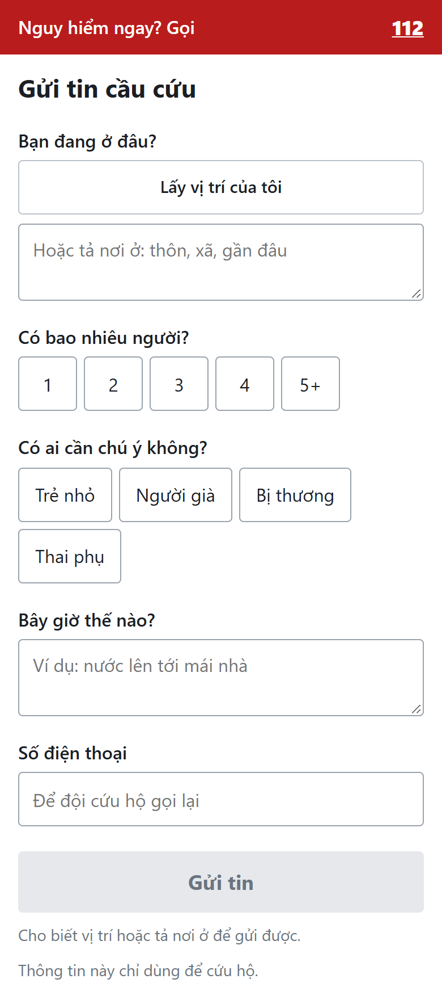
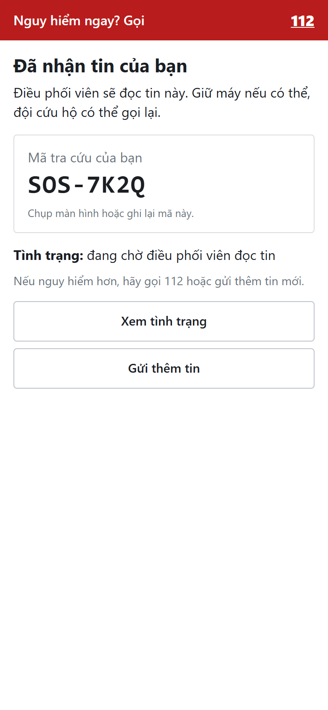
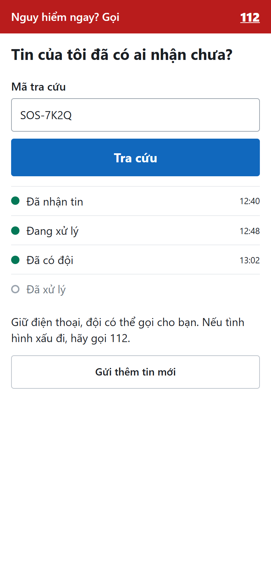
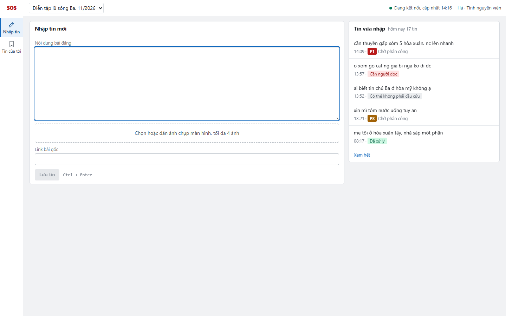
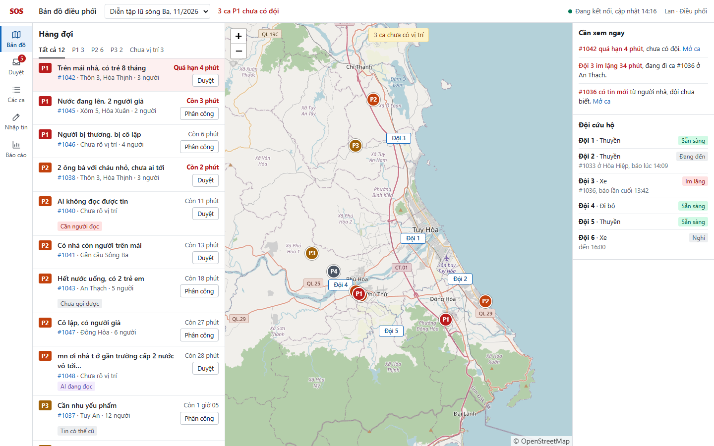
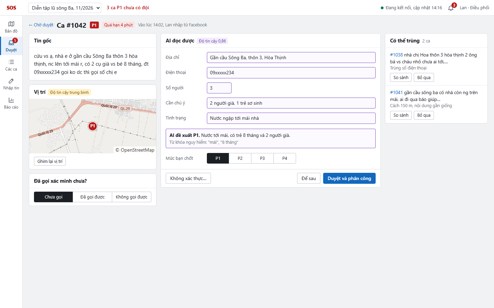
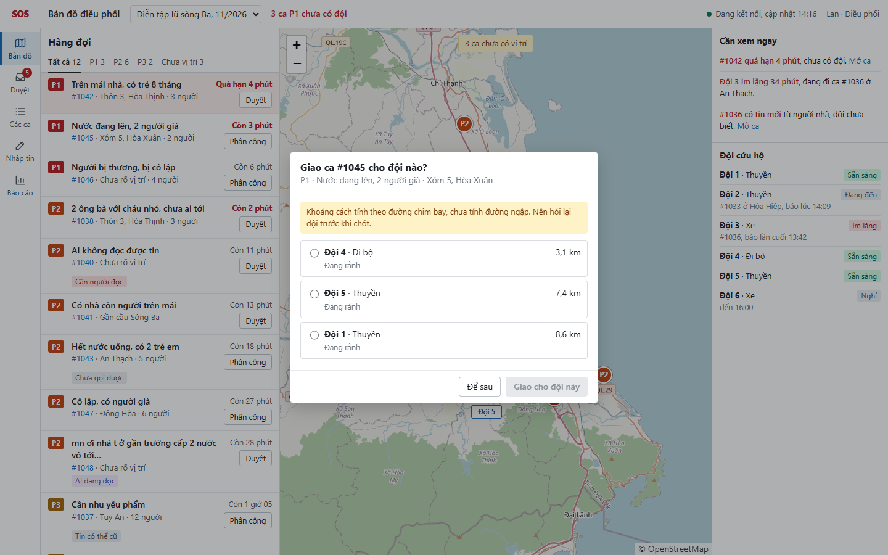
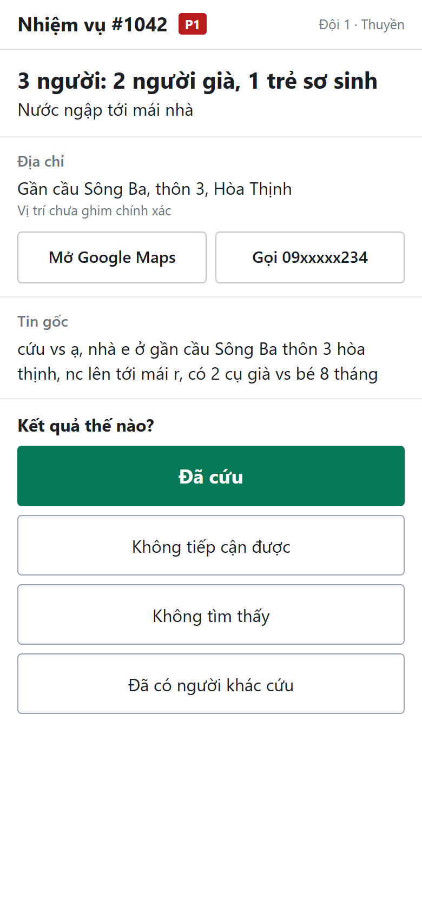
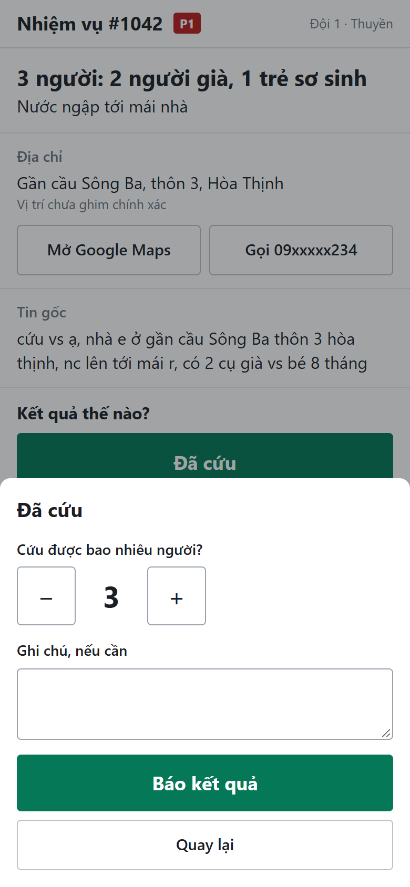
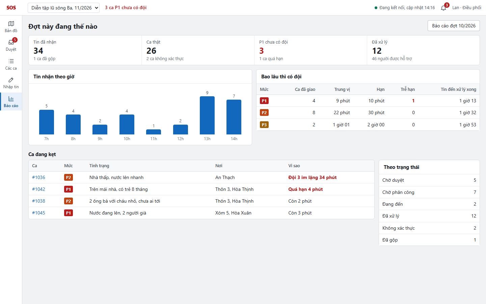

# 06 — UI/UX

> Trạng thái thiết kế: **TARGET V1** · Mức độ: **prototype tĩnh** (chưa nối backend)
>
> Ảnh chụp từ prototype. Toàn bộ dữ liệu trong ảnh là **dữ liệu mẫu**. Đủ các màn hình và trạng thái, chia theo vai trò: [screenshots/README.md](screenshots/README.md).

## 1. Nguyên tắc thiết kế

| # | Nguyên tắc | Áp dụng |
|---|---|---|
| 1 | **Thiết kế cho người đang hoảng loạn** | Form công khai làm được bằng một tay, chọn thay vì gõ, số 112 luôn ở đầu trang |
| 2 | **Luôn thấy tin gốc** | Kết quả AI không bao giờ thay thế tin gốc; cả hai nằm cạnh nhau |
| 3 | **AI nhìn là biết** | Mọi thứ AI tạo ra đều có viền tím, có độ tin cậy và lý do |
| 4 | **Ca nguy hiểm tự nổi lên** | Hàng đợi sắp theo mức ưu tiên và thời gian chờ; ca quá hạn đổi màu |
| 5 | **Không để mất việc khi mất mạng** | Hiển thị rõ khi dữ liệu cũ; form và màn hình đội lưu trên máy rồi tự gửi lại |
| 6 | **Ít chữ, nút lớn ngoài hiện trường** | Màn hình đội dùng nút cao ≥ 56 px |
| 7 | **Không chỉ dựa vào màu** | Mức ưu tiên luôn có chữ P1–P4; dùng được với người mù màu |

## 2. Design tokens

### 2.1 Màu

| Token | Giá trị | Dùng cho |
|---|---|---|
| `p1` | `#B91C1C` / nền `#FEE2E2` | Nguy hiểm tính mạng, quá hạn, nút Gửi tin |
| `p2` | `#C2410C` / nền `#FFEDD5` | Khẩn cấp |
| `p3` | `#A16207` / nền `#FEF9C3` | Cần hỗ trợ |
| `p4` | `#4B5563` / nền `#E5E7EB` | Thông tin |
| `primary` | `#1168BD` / nền `#E8F1FB` | Hành động chính, đội cứu hộ trên bản đồ |
| `ai` | `#7A4FBF` / nền `#F3ECFD` | Dữ liệu do AI tạo |
| `success` | `#047857` / nền `#D1FAE5` | Đã xử lý, đã kết nối |
| `warning` | `#B45309` / nền `#FEF3C7` | Cần chú ý, chưa có vị trí, đang lưu máy |

### 2.2 Chữ và khoảng cách

| Token | Giá trị |
|---|---|
| Font | Font hệ thống của thiết bị: Segoe UI (Windows), San Francisco (Apple), Roboto (Android), dự phòng Arial; mã kỹ thuật dùng Consolas. Không tải font ngoài, để trang nhẹ khi mạng yếu và vẫn hiện đúng tiếng Việt khi mất mạng |
| Cỡ chữ | 12 phụ · 13–14 nội dung · 16–18 tiêu đề · 22–28 số liệu |
| Khoảng cách | Thang 4 px |
| Vùng chạm trên điện thoại | ≥ 44 px; hành động chính của đội ≥ 56 px |
| Breakpoint | `< 768 px` điện thoại · `≥ 1280 px` trung tâm điều phối |

### 2.3 Thành phần dùng chung

| Thành phần | Ghi chú |
|---|---|
| Nhãn ưu tiên | Luôn gồm chữ P1–P4 và màu |
| Thẻ ca | Mức, tóm tắt, vị trí, số người, thời gian còn lại theo hạn |
| Ô dữ liệu AI | Viền tím; đổi về viền thường khi người đã sửa |
| Ghim bản đồ | Tròn: ca; chữ nhật: đội |
| Banner kết nối | Xanh: đang kết nối; đỏ: dữ liệu dừng cập nhật lúc HH:mm |
| Modal xác nhận | Chỉ dùng cho phân công và đóng ca |

## 3. Màn hình chính

Các màn hình dưới đây bao phủ luồng chính: **gửi tin → nhập tin → duyệt → phân công → báo kết quả → báo cáo**.

### 3.1 SCR-01 · Người dân gửi tin (điện thoại)

- Số **112** ở đầu trang: SOSLink không thay thế kênh khẩn cấp chính thức.
- Chỉ mô tả nơi ở là bắt buộc nếu không có GPS; số người và nhóm yếu thế chỉ cần bấm chọn.
- Trang rất nhẹ cho mạng yếu; mất mạng thì giữ nội dung và cho gửi lại.

### 3.2 SCR-02 + SCR-03 · Đã gửi và tra cứu (điện thoại)

 

- Trả lời đúng câu người gửi đang lo: "Tin của tôi có ai nhận chưa?" (P7).
- Chỉ hiện tiến trình tổng quát, không hiện dữ liệu cá nhân, vì ai có mã đều xem được.

### 3.3 SCR-10 · Tình nguyện viên nhập tin

- Dán, bấm `Ctrl + Enter`, ô trống lại: tối ưu cho thao tác lặp liên tục.
- AI xử lý ở nền, không bắt tình nguyện viên phải chờ.
- Tình nguyện viên chỉ thấy tin của mình; menu chỉ có Nhập tin và Tin của tôi.

### 3.4 SCR-20 · Bản đồ điều phối

| Vùng | Hành vi |
|---|---|
| Hàng đợi (trái) | Sắp theo ưu tiên rồi thời gian chờ; đếm ngược theo hạn; ca quá hạn nền đỏ |
| Bản đồ (giữa) | Ghim ca và đội; bấm ghim để mở ca |
| Cảnh báo, đội (phải) | Ca quá hạn, đội không cập nhật; trạng thái từng đội |
| Thanh trên | Đợt đang chọn, số ca P1 chưa có đội, trạng thái kết nối |

Ca chưa có vị trí vẫn nằm trong hàng đợi và có bộ đếm riêng, để không biến mất chỉ vì không hiện được trên bản đồ.

### 3.5 SCR-22 · Duyệt ca

- **Trái:** tin gốc, vị trí, ghi nhận xác minh. **Giữa:** kết quả AI viền tím, mức ưu tiên kèm lý do. **Phải:** ca có thể trùng.
- AI chỉ đề xuất gộp, có nút So sánh và Bỏ qua.
- Hạ mức ưu tiên bắt buộc ghi lý do; nâng mức không cần.
- Giá trị người sửa được lưu để đo chất lượng AI.

### 3.6 SCR-24 · Phân công đội

- Tối đa 3 gợi ý kèm phương tiện, khoảng cách, số nhiệm vụ đang làm.
- **Cảnh báo rõ** rằng khoảng cách chưa tính đường ngập. Người điều phối vẫn là người quyết định.

### 3.7 SCR-31 + SCR-32 · Đội cứu hộ (điện thoại)

 

- Thông tin quan trọng nhất ở trên cùng: số người, nhóm yếu thế, tình trạng.
- Nút mở Google Maps và gọi điện; luôn thấy tin gốc.
- Báo kết quả bằng nút lớn. Mất mạng thì báo đã lưu bao nhiêu cập nhật và sẽ gửi khi có mạng.

### 3.8 SCR-40 · Dashboard theo đợt

- Cho thấy hệ thống có đạt thời hạn không. Chất lượng AI xem riêng ở SCR-53.
- Danh sách "Ca đang kẹt" nêu rõ vì sao từng ca bị kẹt: quá hạn, đội im lặng, sắp hết hạn.

## 4. Trạng thái màn hình

Xem chi tiết tại [05-information-architecture.md](05-information-architecture.md#7-trạng-thái-màn-hình).

## 5. Khả năng truy cập

- Độ tương phản chữ và nền ≥ 4.5:1 (WCAG AA); các cặp màu cần kiểm tra lại bằng công cụ khi dựng giao diện thật.
- Mọi thao tác ở trung tâm điều phối dùng được bằng bàn phím: `J`/`K` chuyển ca, `A` phân công, `Enter` duyệt.
- Form công khai có nhãn thật, cỡ chữ ≥ 16 px trên điện thoại để không bị tự phóng to.

## 6. Bước tiếp theo

- Cho 2–3 người chưa biết sản phẩm thử gửi tin trên điện thoại, đo thời gian và lỗi.
- Cho điều phối viên thật xem SCR-20 và SCR-22, hỏi có thiếu thông tin nào để ra quyết định không.

---

**Liên quan:** [Information architecture](05-information-architecture.md) · [User stories](04-user-stories.md)
