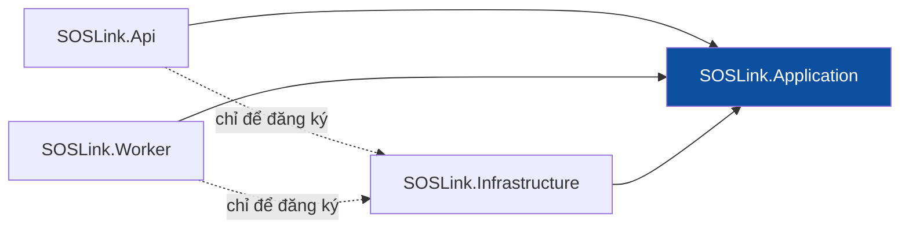

# 08 — Code Structure

> Design status: **TARGET V1** · The `src/` folder does not exist yet. This is the structure to use when coding starts.

This document defines where code lives and what it may depend on. The technology is a default choice (React + Vite, ASP.NET Core) and can change; see [C4](architecture/c4/README.md#technology).

## 1. Principles

1. The interface holds no real permission rules; the backend always checks again.
2. Controllers contain neither SQL nor business rules.
3. Application knows nothing of ASP.NET Core, EF Core, PostgreSQL or the Claude API. It only uses interfaces it defines itself.
4. Resource names, DTOs and endpoints follow the [OpenAPI](api/openapi.yaml) exactly.
5. Code is shared only when at least two places use it.

## 2. Top level

```text
soslink/
├── README.md
├── compose.yaml                 # PostgreSQL + PostGIS, API, Worker, Web
├── .env.example                 # Configuration variable names, no real values
├── redocly.yaml                 # Turns off accepted OpenAPI warnings
├── docs/
│   ├── 01-research.md … 08-code-structure.md
│   ├── api/                     # openapi.yaml, README.md
│   ├── architecture/c4/
│   ├── database/soslink.dbml
│   ├── mindmap/ · screenshots/ · usecase/
├── src/
│   ├── frontend/                # React + Vite
│   ├── backend/                 # ASP.NET Core
│   └── database/seed/           # Demo data, danger keywords, administrative units
└── tools/
    └── ai-eval/                 # Scores AI on 100–200 posts with personal data removed
```

## 3. Frontend

```text
src/frontend/
├── index.html
├── package.json
├── vite.config.js
├── public/
│   └── manifest.webmanifest
└── src/
    ├── main.jsx
    ├── app/
    │   ├── App.jsx
    │   ├── routes.jsx               # Routes per 05-information-architecture.md section 4
    │   └── RoleGuard.jsx            # Wrong role goes to the 403 page
    ├── features/
    │   ├── auth/                    # SCR-04, SCR-05
    │   ├── profile/                 # SCR-06
    │   ├── public-sos/              # SCR-01, SCR-02, SCR-03; separate bundle, no Leaflet
    │   ├── intake/                  # SCR-10, SCR-11
    │   ├── command/                 # SCR-20: map, queue, team column
    │   ├── review/                  # SCR-21, SCR-22, SCR-23
    │   ├── cases/                   # SCR-25, SCR-26
    │   ├── dispatch/                # SCR-24
    │   ├── alerts/                  # SCR-27
    │   ├── missions/                # SCR-30, SCR-31, SCR-32
    │   ├── analytics/               # SCR-40, SCR-41
    │   └── admin/
    │       ├── events/              # SCR-50
    │       ├── users/               # SCR-51
    │       ├── teams/               # SCR-52
    │       ├── ai-quality/          # SCR-53
    │       └── audit/               # SCR-54
    ├── components/
    │   ├── layout/                  # AppShell, TopBar, Rail, ConnectionBanner
    │   ├── feedback/                # EmptyState, ErrorState, Skeleton
    │   └── data-display/            # DataTable, PriorityBadge, StatusTag, CaseClock
    ├── services/
    │   ├── apiClient.js             # Base URL, Bearer token, error mapping by errorCode
    │   ├── endpoints.js             # Paths per OpenAPI
    │   └── liveHub.js               # SignalR connection, reconnecting, loading missed changes
    ├── offline/
    │   ├── outbox.js                # IndexedDB queue
    │   ├── syncOutbox.js            # Resends using idempotencyKey and clientUpdateId
    │   └── serviceWorker.js         # Caches the page shell so it opens offline
    ├── hooks/                       # useOnline, usePagination, useCurrentEvent
    ├── lib/                         # Pure functions: Vietnam time, time left, masking numbers
    ├── styles/                      # tokens.css per 06-ui-ux.md section 2
    └── test/
```

Every feature has the same structure; folders it does not need are left out:

```text
features/missions/
├── pages/                  # MissionListPage.jsx, MissionDetailPage.jsx
├── components/             # IncomingMission.jsx, OutcomeSheet.jsx
├── hooks/                  # useMission.js
├── services/missionService.js
└── mission.contracts.js    # Describes data per OpenAPI
```

Call flow: `Page → Hook → Feature service → apiClient → API`. Only a feature service may call `apiClient`. Features may use shared code; shared code must not import a feature.

## 4. Backend

```text
src/backend/
├── SOSLink.sln
├── Directory.Build.props
├── src/
│   ├── SOSLink.Api/                     # Process that receives requests
│   │   ├── Controllers/                 # One controller per OpenAPI tag
│   │   │   ├── PublicController.cs
│   │   │   ├── AuthController.cs
│   │   │   ├── ProfileController.cs
│   │   │   ├── EventsController.cs
│   │   │   ├── ConfigController.cs
│   │   │   ├── ReportsController.cs
│   │   │   ├── CasesController.cs
│   │   │   ├── DispatchController.cs
│   │   │   ├── AlertsController.cs
│   │   │   ├── TeamsController.cs
│   │   │   ├── MissionsController.cs
│   │   │   ├── AnalyticsController.cs
│   │   │   ├── UsersController.cs
│   │   │   ├── AuditLogsController.cs
│   │   │   ├── ZaloWebhookController.cs
│   │   │   └── HealthController.cs
│   │   ├── Contracts/                   # DTOs per OpenAPI
│   │   ├── Hubs/
│   │   │   ├── LiveHub.cs
│   │   │   └── LiveEventBridge.cs       # Listens for NOTIFY and pushes through SignalR
│   │   ├── Middleware/ProblemDetailsMiddleware.cs
│   │   ├── Authorization/               # JWT, account status check
│   │   ├── RateLimiting/PublicFormLimiter.cs
│   │   ├── Program.cs
│   │   └── appsettings.json
│   ├── SOSLink.Worker/                  # Background work process
│   │   ├── Jobs/
│   │   │   ├── AiExtractionJob.cs       # Takes PENDING messages, including those awaiting retry
│   │   │   ├── SlaCheckJob.cs           # Every minute: overdue, acceptance timeout, silent teams
│   │   │   └── AnonymizeJob.cs          # Daily: events closed more than 90 days ago
│   │   ├── Program.cs
│   │   └── appsettings.json
│   ├── SOSLink.Application/             # Business logic, framework-independent
│   │   ├── Abstractions/
│   │   │   ├── Persistence/             # IReportRepository, ICaseRepository, IAssignmentRepository,
│   │   │   │                            # ITeamUpdateRepository, IReportQueue, IUnitOfWork
│   │   │   ├── Ai/IAiExtractor.cs
│   │   │   ├── Geocoding/IGeocoder.cs
│   │   │   ├── Files/IFileStorage.cs
│   │   │   ├── Realtime/IRealtimeNotifier.cs
│   │   │   ├── Identity/                # IPasswordHasher, ITokenIssuer
│   │   │   └── Time/IClock.cs
│   │   ├── Common/                      # ActorContext, PagedResult, AppException
│   │   ├── Identity/                    # AuthService, InvitationService
│   │   ├── Users/
│   │   ├── Events/                      # EventService, DangerKeywordService
│   │   ├── Intake/                      # IntakeService, ZaloMessageMapper
│   │   ├── Extraction/                  # ExtractionPipeline, DangerKeywordMatcher, PriorityPolicy,
│   │   │                                # DuplicateFinder, AiOutput
│   │   ├── Cases/                       # CaseService, CaseStateMachine, CaseAccessPolicy,
│   │   │                                # MergeService, VerificationService
│   │   ├── Dispatch/                    # DispatchService, TeamSuggester
│   │   ├── Teams/
│   │   ├── Missions/                    # MissionService
│   │   ├── Alerts/                      # AlertService
│   │   ├── Analytics/                   # DashboardService, AfterActionService, AiQualityService
│   │   ├── Audit/
│   │   └── Privacy/AnonymizationService.cs
│   └── SOSLink.Infrastructure/          # Implements Application's interfaces
│       ├── Persistence/
│       │   ├── SosLinkDbContext.cs
│       │   ├── Configurations/
│       │   ├── Repositories/
│       │   ├── PostgresReportQueue.cs   # FOR UPDATE SKIP LOCKED
│       │   └── Migrations/              # Includes partial unique indexes, CHECKs, PostGIS
│       ├── Ai/
│       │   ├── ClaudeAiExtractor.cs     # Model from configuration, 30-second timeout
│       │   └── Prompts/
│       ├── Geocoding/                   # GoongGeocoder, NominatimGeocoder
│       ├── Files/LocalFileStorage.cs
│       ├── Realtime/PostgresNotifier.cs
│       ├── Excel/ExcelExporter.cs
│       └── Identity/                    # PasswordHasher, JwtTokenIssuer
└── tests/
    ├── SOSLink.Application.Tests/       # PriorityPolicy, CaseStateMachine, merging, permissions, no duplicates
    ├── SOSLink.Infrastructure.Tests/    # Queue, partial unique index, anonymisation
    └── SOSLink.Api.Tests/               # Contract per OpenAPI, 401/403, no data leaks on the lookup page
```

### Dependency rules



- `Application` references no other project.
- `Infrastructure` implements interfaces defined by `Application`.
- `Api` and `Worker` touch `Infrastructure` only in `Program.cs`, to register dependency injection.
- `Api` and `Worker` do not call each other directly. They communicate through PostgreSQL.
- There is no separate Domain project, because V1 does not need one; business rules live in `Application`.

## 5. Module mapping

| Backend module | API tag | Main tables | Stories | Screens |
|---|---|---|---|---|
| `Identity` | Auth, Profile | `users`, `invitations` | US01, US02, US21 | SCR-04, SCR-05, SCR-06 |
| `Users` | Users | `users`, `invitations` | US21 | SCR-51 |
| `Events` | Events, Config | `disaster_events`, `danger_keywords`, `admin_units` | US23 | SCR-50 |
| `Intake` | Public, Reports, Webhooks | `reports`, `report_attachments`, `cases` | US03, US04, US05, US06 | SCR-01, SCR-02, SCR-03, SCR-10, SCR-11 |
| `Extraction` | None, runs in the Worker | `ai_extractions`, `cases`, `merge_suggestions` | US07, US08, US09, US10 | Shown in SCR-22 |
| `Cases` | Cases | `cases`, `case_field_corrections`, `merge_suggestions`, `verification_logs`, `case_events` | US11, US12, US13, US14 | SCR-20, SCR-21, SCR-22, SCR-23, SCR-25, SCR-26 |
| `Dispatch` | Dispatch | `assignments`, `teams` | US15 | SCR-24 |
| `Alerts` | Alerts | `alerts`, `job_runs` | US16 | SCR-27 |
| `Teams` | Teams | `teams` | US14, US22 | SCR-20, SCR-52 |
| `Missions` | Missions | `assignments`, `team_updates`, `cases` | US17, US18 | SCR-30, SCR-31, SCR-32 |
| `Analytics` | Analytics | `cases`, `reports`, `assignments`, `ai_extractions`, `case_field_corrections` | US19, US20 | SCR-40, SCR-41, SCR-53 |
| `Audit`, `Privacy` | Audit | `audit_logs`, `job_runs` | US24 | SCR-54 |

## 6. Configuration

Real values do not go into git; `.env.example` only lists variable names.

| Variable | Used for |
|---|---|
| `ConnectionStrings__Default` | PostgreSQL |
| `Jwt__SigningKey` | Signing JWTs, 60-minute lifetime |
| `Ai__ApiKey`, `Ai__Model`, `Ai__TimeoutSeconds` | Claude API; default timeout 30 seconds |
| `Geocoder__Provider`, `Geocoder__ApiKey` | `Goong` or `Nominatim` |
| `Files__RootPath` | Image store, outside the web folder |
| `Zalo__OaSecretKey` | Checking the webhook signature |

## 7. Running locally

`compose.yaml` runs four services: `db` (PostGIS), `api` (port 5000), `worker`, `web` (port 5173). Images live in a volume shared by `api` and `worker`. When coding starts, follow the backlog order: Sprint 1 is accounts, events, teams and the intake flow.

---

**Related:** [C4](architecture/c4/README.md) · [API](api/README.md) · [Data model](07-data-model.md) · [Information architecture](05-information-architecture.md)
