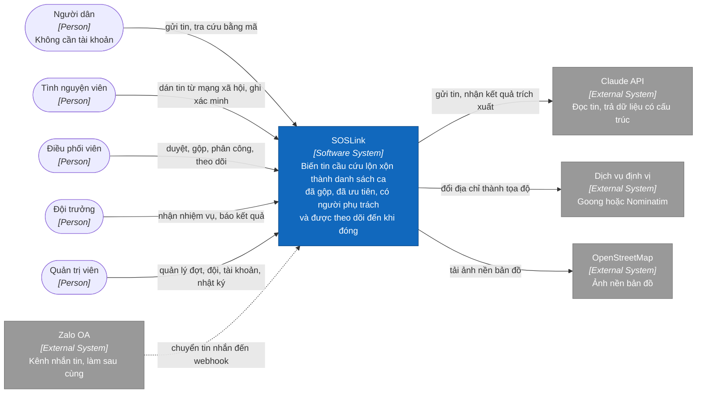

# C1 — System Context

> Design status: **TARGET V1** · Shows who uses SOSLink and which systems it connects to, without internal technology.

## System boundary

SOSLink handles receiving messages, extraction, suggestions, review, assignment, tracking and reporting. The following are outside V1 and so not on the diagram: automatically scanning social media, replacing the 112 hotline, phone calls and SMS, managing relief goods. The full list is in [scope](../../02-scope.md#2-out-of-scope).

The number 112 is only shown on public pages for residents to call themselves; the system does not connect to the hotline. Volunteers read Facebook and Zalo groups by eye and paste messages in, so those two platforms are not external systems either.

## Users

| User | Main work | Device, situation |
|---|---|---|
| Resident | Sends messages, looks up by code | Phone, weak network, panicking |
| Volunteer | Pastes messages or screenshots, records verification calls | Laptop or phone, repetitive work |
| Coordinator | Reviews cases, merges messages, assigns teams, views reports | Large screen, long shifts |
| Team leader | Accepts or declines missions, reports outcomes | Phone outdoors, may lose network |
| Administrator | Full coordination rights, plus accounts, teams, configuration, audit log | Large screen |

## External systems

| System | Used for | When it fails |
|---|---|---|
| Claude API | Extracting information and suggesting a priority | Messages still enter the queue at P2, labelled `CẦN NGƯỜI ĐỌC` (needs a human read) (BR03, BR07) |
| Geocoding service | Turning addresses into coordinates | Cases still enter the queue, labelled `CHƯA CÓ VỊ TRÍ` (no location), awaiting a manual pin |
| OpenStreetMap | Base map images, loaded directly by the browser | The map loses its background; the queue still works |
| Zalo OA | An extra intake channel (US06, Could group) | Public form and pasting still work |

---

**Next:** [C2 — Containers](02-container.md) · **Related:** [Use cases](../../03-use-cases.md)
