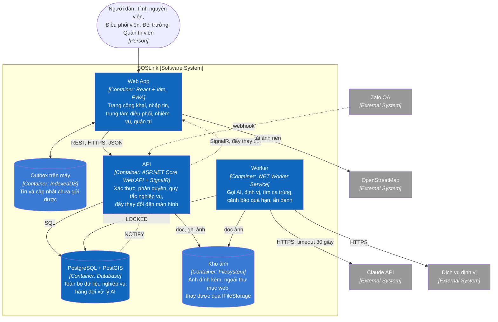

# C2 — Containers

> Design status: **TARGET V1** · Zooms into SOSLink and shows the runtime and storage units.

## Responsibilities

| Container | Technology | Responsibility | Does not |
|---|---|---|---|
| Web App | React, Vite, Leaflet, service worker | Four interfaces, working offline on the form and team screens | Hold the real permission rules |
| On-device outbox | IndexedDB | Keeps unsent messages and updates, resends when online | Keep data long term |
| API | ASP.NET Core, SignalR | Trust boundary: authentication, permissions, rules, audit logging | Call the Claude API |
| Worker | .NET Worker Service | Background work: AI, geocoding, duplicate search, overdue checks, anonymisation | Receive user requests |
| PostgreSQL + PostGIS | PostgreSQL | Business data, AI queue, `NOTIFY` signals | Store image files |
| Image store | Disk, through `IFileStorage` | Stores images under system-generated keys | Check permissions |

## Architecture decisions

| Decision | Why | Trade-off |
|---|---|---|
| Separate the Worker from the API as two processes | Slow or failing AI must not slow intake (BR07) | One more service to deploy |
| Queue inside PostgreSQL: `reports.ai_status = PENDING`, taken with `FOR UPDATE SKIP LOCKED` | A message and the work on it are written in one transaction and cannot diverge. One coordinating unit does not need Redis or RabbitMQ | Not suited to very high volume; change it only then |
| The Worker signals the API with `LISTEN/NOTIFY` | No extra infrastructure; enough for the 5-second update requirement (US14) | Signals can be lost, so clients call `listCases` again after reconnecting |
| SignalR pushes changes to screens | Picks WebSocket and reconnects on its own | Tied to ASP.NET Core |
| Service worker and IndexedDB instead of a native app | Works on any phone with nothing to install (02-scope section 2) | iPhones limit background work more than Android |
| Teams are notified only through SignalR while the page is open | Simple, enough for a demo | A team without the page open gets no notification. Web Push comes later; on timeout the case returns to the queue with an alert (BR15) |

## When a block fails

| Failed block | What happens |
|---|---|
| Claude API | The message is still saved and the case is P2 with the label `CẦN NGƯỜI ĐỌC`. The Worker retries up to 3 times |
| Worker | The API still receives messages and creates cases at the safe level. Coordinators read by hand. `GET /health` reports `degraded` |
| Geocoding service | The case still enters the queue with the label `CHƯA CÓ VỊ TRÍ`, and the coordinator pins it by hand |
| Realtime connection | Banner saying data has stopped updating, assign button locked, missed changes loaded on reconnect |
| Team's or resident's network | Data sits in the outbox and is resent, and the server creates no duplicates |
| PostgreSQL | The API cannot receive messages. The Web App keeps the content in the outbox and reminds people to call 112 |

## Architecture rules

1. The browser never connects directly to PostgreSQL or the Claude API.
2. Hiding a button in the interface is only for usability; the API checks permissions on every request.
3. The original message is saved before AI is called (BR01).
4. AI only returns data. The Worker has no path for AI to assign, merge or close a case on its own (BR02, BR06).
5. PostgreSQL stores only information about images; image files go through `IFileStorage`.

---

**Previous:** [C1 — System Context](01-system-context.md) · **Next:** [C3 — Components](03-component.md)
