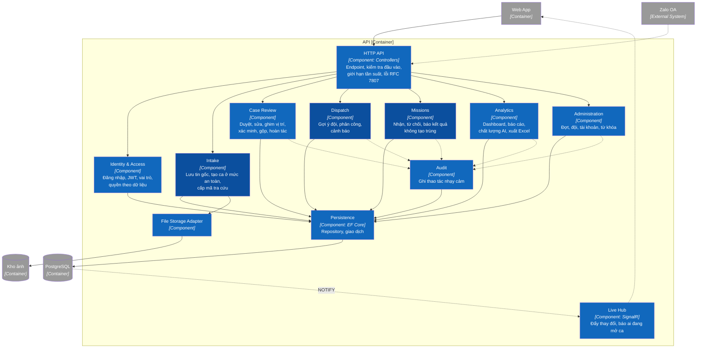
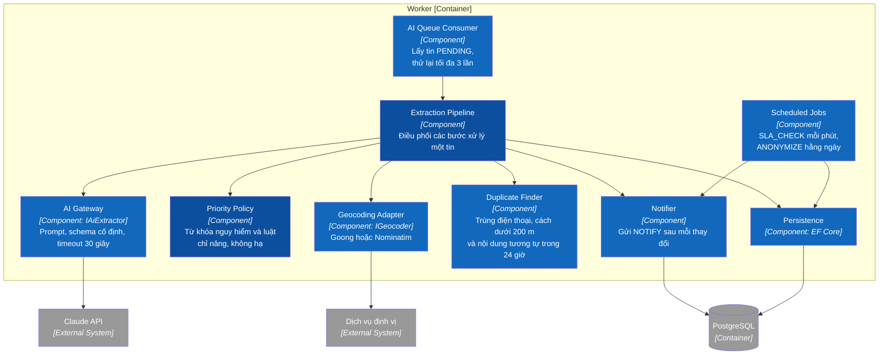

# C3 — Components

> Design status: **TARGET V1** · Zooms into the two backend blocks. These components have no code yet.

## 1. API

| Component | Owns | Does not own |
|---|---|---|
| HTTP API | Protocol, input validation, error mapping | SQL, business decisions |
| Identity & Access | Login, lockout after 5 failures, roles, data-level permissions (BR20) | What the interface shows or hides |
| Intake | Saving messages before any processing, duplicate-send protection, creating P2 cases awaiting a human read | Calling AI |
| Case Review | Case lifecycle from `NEW` to `TRIAGED`, `MERGED`, `INVALID`; stores AI values and final human values | Assigning teams |
| Dispatch | Suggesting up to 3 teams, preventing duplicate assignment, acknowledging alerts | Picking a team on its own (BR14) |
| Missions | Team updates, resending without duplicates, moving cases to `RESOLVED` or `TRIAGED` | Personal data after a mission ends (BR20) |
| Analytics | Aggregate queries, Excel export | Changing business data |
| Administration | Events, deadlines, teams, accounts, danger keywords | Hard deletes |
| Audit | Phone views, data exports, priority changes, assignments, merges, case closures (AC-US24) | The case timeline |
| Live Hub | Pushing IDs and statuses, no personal data | Business decisions |
| Persistence | Repositories, transactions, optimistic locking | Business rules |
| File Storage Adapter | Format checks, key generation, reading and writing files | Permission to view images |

Dependency direction: `HTTP API → Identity & Access → business component → Persistence → PostgreSQL`. No business component opens its own database connection.

## 2. Worker

| Component | Owns | Does not own |
|---|---|---|
| AI Queue Consumer | Taking work, counting attempts, writing `ai_status` | Understanding message content |
| Extraction Pipeline | Order of steps; one failing step does not damage the case | Changing case status |
| AI Gateway | Calling the Claude API; model from configuration; message content is only data (BR06) | Deciding the final level |
| Priority Policy | Takes the higher of AI and keywords; confidence below 0.6 means at least P2 (BR03, BR04) | Lowering the level |
| Geocoding Adapter | Turning addresses into coordinates with a confidence value | Overriding a location a person pinned |
| Duplicate Finder | Creates `merge_suggestions` with a reason | Merging on its own (BR02, BR09) |
| Scheduled Jobs | Overdue alerts, returning cases when a team misses the acceptance deadline, anonymising after 90 days | Repeating an unacknowledged alert |
| Notifier | Tells the API something changed | Sending personal data |

## 3. Why it is split this way

- The API and the Worker share the `SOSLink.Application` business layer, so each rule is written only once.
- Priority Policy is separate from AI Gateway so it runs when AI fails, and can be tested without calling the real API.
- Only the Worker calls the Claude API, so AI errors cannot block an intake request.

---

**Previous:** [C2 — Containers](02-container.md) · **Next:** [C4 — Code](04-code.md)
