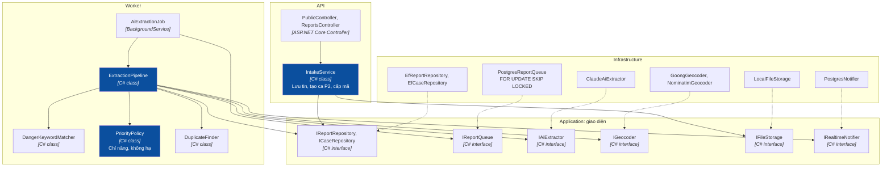
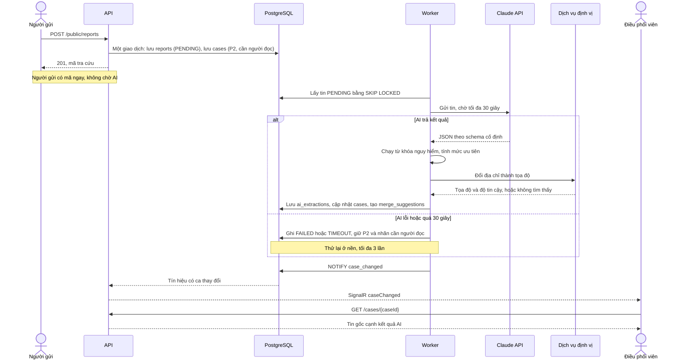
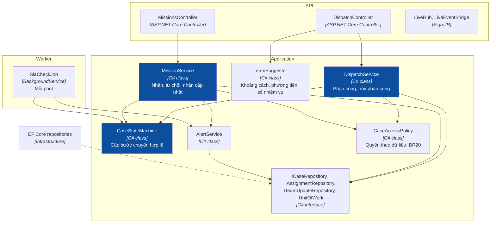
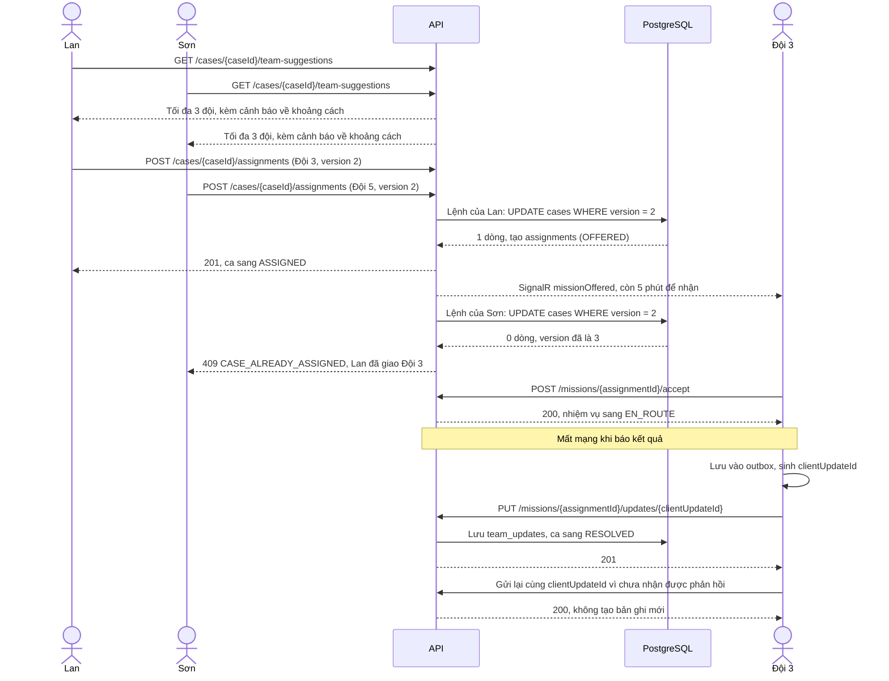

# C4 — Code

> Design status: **TARGET V1** · Class-level design for the two core flows. No code yet; each file's location is in the [code structure](../../08-code-structure.md).

## 1. Message intake and AI processing



The final level is computed by `PriorityPolicy`, not taken directly from AI:

```text
level = the higher of (AI suggestion, level from danger_keywords)
if confidence < 0.6 or AI failed: level is at least P2, needs_human_read = true
```



## 2. Assignment and outcome reporting



Two layers block duplicate assignment: `UPDATE cases ... WHERE version = @version` in the application, and a partial unique index on `assignments.case_id` in the database.



## 3. Shared rules

1. Controllers contain neither SQL nor business rules.
2. Services depend on interfaces, not directly on PostgreSQL or the Claude API.
3. Every case status change goes through `CaseStateMachine` and writes a row to `case_events` (BR17).
4. Data-level permissions are always checked in Application, so the API and the Worker share one set of rules.
5. `IAiExtractor` only returns data. It holds no reference to any service with write access.
6. Write tests for `PriorityPolicy` and `CaseStateMachine` first, because errors in these two affect safety.

---

**Previous:** [C3 — Components](03-component.md) · **Related:** [Code structure](../../08-code-structure.md) · [API](../../api/README.md) · [Scope & rules](../../02-scope.md)
