# C4 — SOSLink

> Design status: **TARGET V1** · No code yet; the diagrams describe the target architecture. Diagram labels are in Vietnamese.

The documents go from the outside in. Each block has a name, a type, its technology where relevant, and a short description.

```mermaid
flowchart LR
    C1["C1 · System Context<br/><small>Ai dùng hệ thống?</small>"]
    C2["C2 · Container<br/><small>Gồm những khối chạy nào?</small>"]
    C3["C3 · Component<br/><small>API và Worker chia ra sao?</small>"]
    C4["C4 · Code<br/><small>Hai luồng cốt lõi tổ chức thế nào?</small>"]
    C1 -->|"phóng vào SOSLink"| C2
    C2 -->|"phóng vào API, Worker"| C3
    C3 -->|"phóng vào tiếp nhận, phân công"| C4
    style C1 fill:#1168bd,color:#fff,stroke:#0b4884
    style C2 fill:#1168bd,color:#fff,stroke:#0b4884
    style C3 fill:#1168bd,color:#fff,stroke:#0b4884
    style C4 fill:#1168bd,color:#fff,stroke:#0b4884
```

| Level | Document | Scope |
|---|---|---|
| C1 | [System context](01-system-context.md) | Five user groups, four external systems |
| C2 | [Containers](02-container.md) | Web App, API, Worker, PostgreSQL, image store, on-device outbox |
| C3 | [Components](03-component.md) | Components inside the API and the Worker |
| C4 | [Code](04-code.md) | Classes and interfaces of two flows: intake through AI, assignment through outcome |

## Current status

| Block | Reality |
|---|---|
| Interface | Design and screenshots in [docs/screenshots](../../screenshots/README.md), no code yet |
| API, Worker | No code yet; contract in [OpenAPI](../../api/openapi.yaml) |
| PostgreSQL | Designed in [soslink.dbml](../../database/soslink.dbml), not created |

## Technology

The documents have only settled on PostgreSQL, Claude API and OpenStreetMap maps. The rest is a default choice: React + Vite for the interface, ASP.NET Core for the backend. Changing the technology only affects C3, C4 and the [code structure](../../08-code-structure.md); C1, the API contract and the data model stay the same.

## Colour conventions

- Dark blue: the main block being described.
- Light blue: a neighbouring block in the same system.
- Grey: a user or system outside the boundary in question.
- Dashed line: an asynchronous flow, or an interface implementation.

---

**Related:** [Use cases](../../03-use-cases.md) · [API](../../api/README.md) · [Code structure](../../08-code-structure.md)
